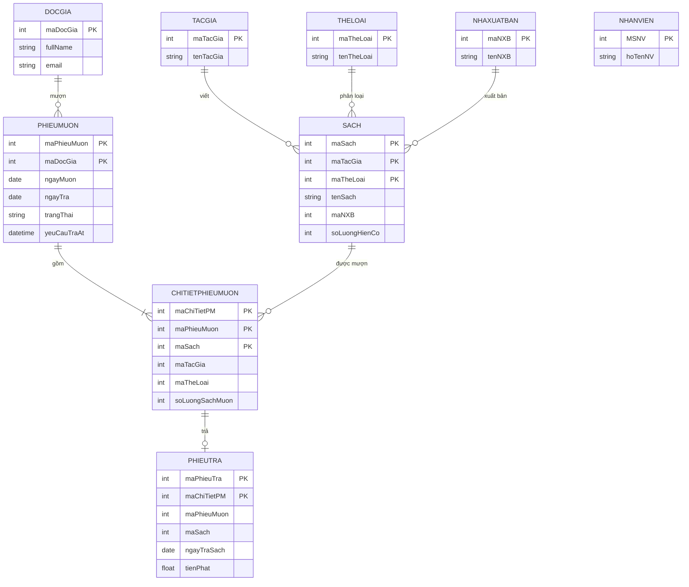
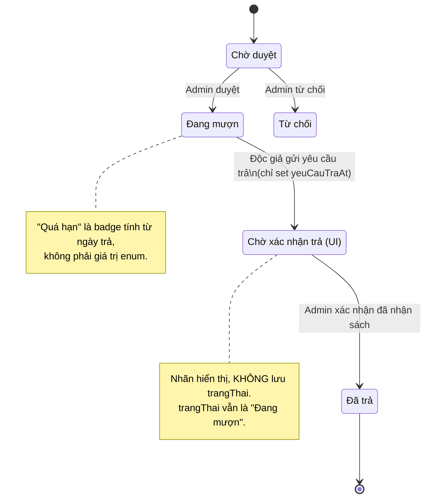
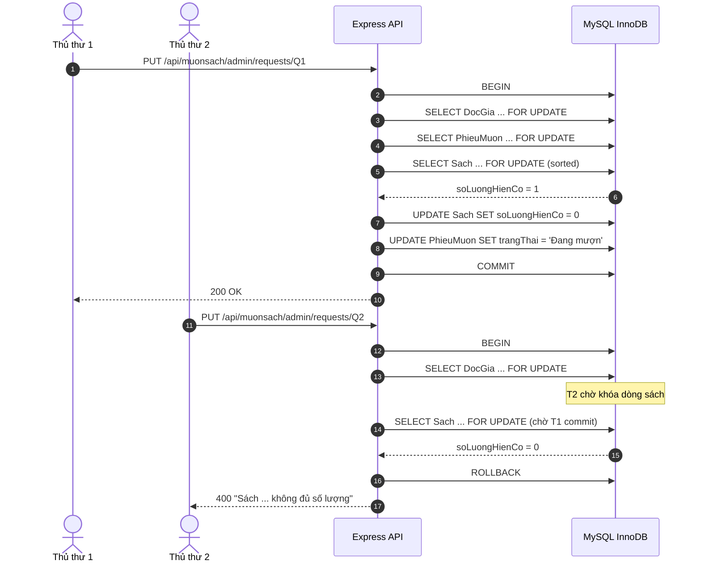
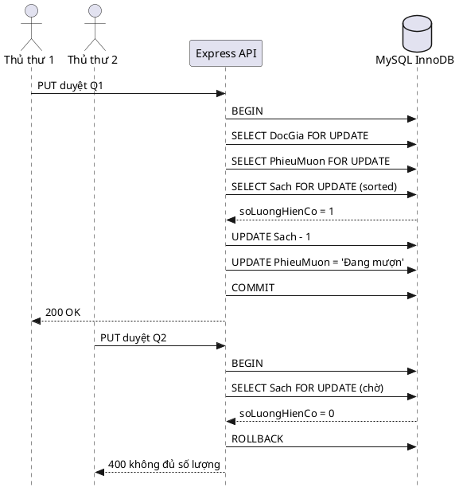
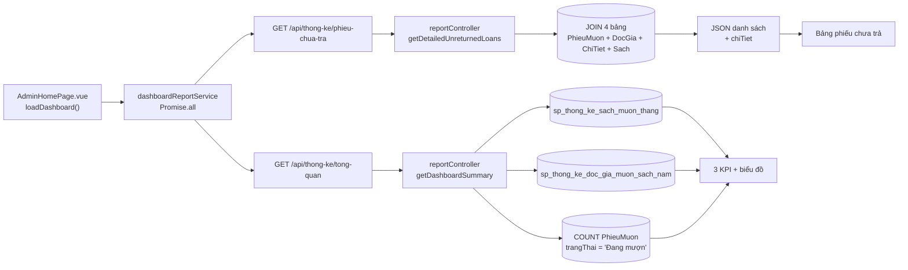
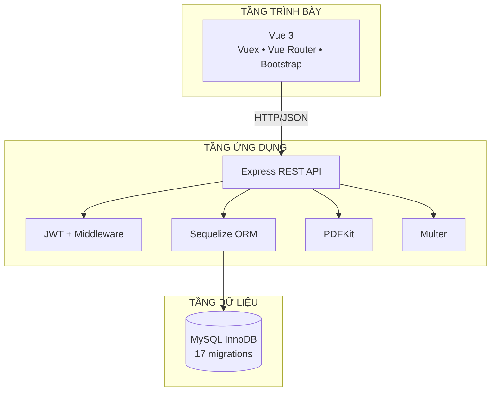
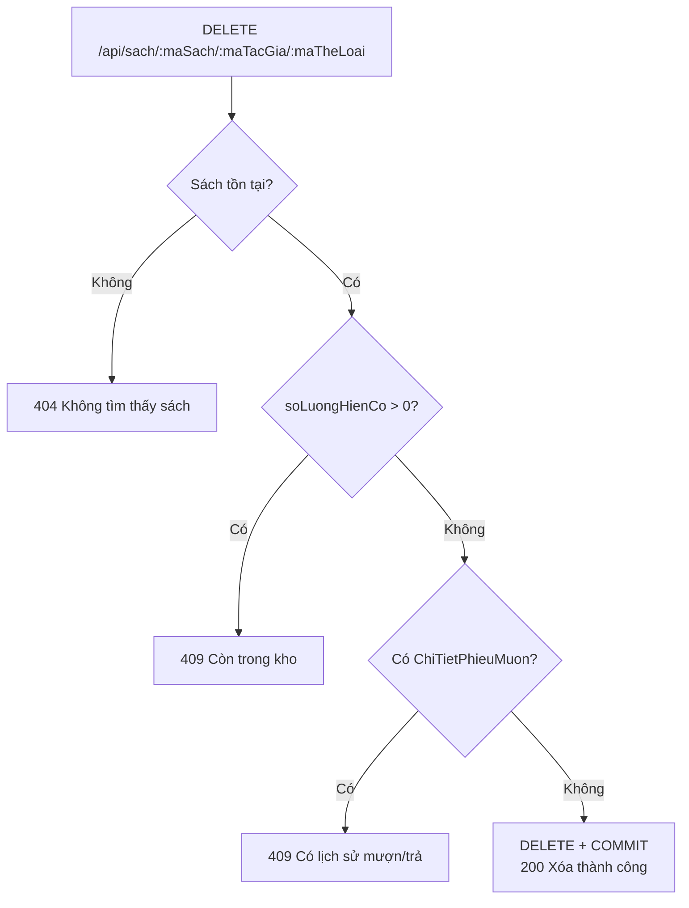
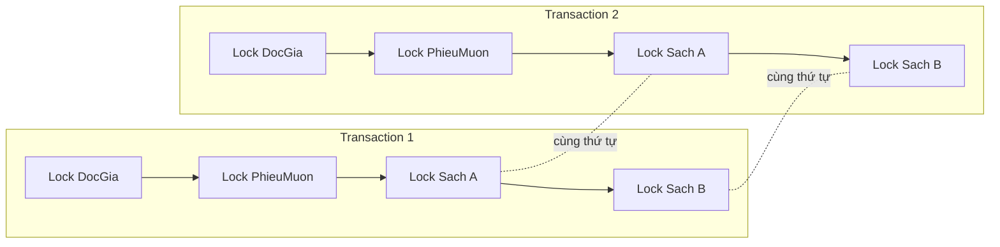

# HƯỚNG DẪN SẢN XUẤT SLIDE
## Hệ thống Quản lý Thư viện — Đồ án CT467

> **Vai trò tài liệu:** Đây là bản thiết kế sản xuất slide, không phải lời thoại. Mỗi slide đều chỉ rõ: dựng bằng layout nào, đưa nội dung gì lên màn hình, cần ảnh chụp/sơ đồ nào, chú thích ra sao, nguồn bằng chứng ở đâu và người nói dùng slide đó trong bao lâu.
>
> **Tài liệu đi kèm:** `presentation.md` — kịch bản nói, demo và Q&A. Khi lời thoại và slide khác nhau, ưu tiên sửa slide theo `presentation.md`, không thêm số liệu mới chưa kiểm chứng.
>
> **Phiên bản:** 1.0 — 08/11/2026. **Người phụ trách:** D — Vũ. **Ngôn ngữ:** tiếng Việt, giữ nguyên thuật ngữ kỹ thuật khi cần.

---

## 0. CÁCH DÙNG TÀI LIỆU

### 0.1. Ba nguyên tắc

1. **Một slide — một ý.** Nếu một slide có hai thông điệp, tách thành hai slide hoặc chuyển một phần sang backup.
2. **Mỗi ý phải có bằng chứng.** Bằng chứng có thể là ảnh chụp màn hình, sơ đồ, một đoạn code 5–10 dòng, kết quả test hoặc kết quả SQL. Không đưa số liệu “ước chừng” lên slide.
3. **Slide phục vụ demo, không thay demo.** Slide giữ nhịp và giải thích cơ chế; thao tác thật diễn ra trên browser/Workbench/terminal.

### 0.2. Quy ước trạng thái

- **[BẮT BUỘC]** — phải có trước khi xuất PDF.
- **[TÙY CHỌN]** — có thì tốt, thiếu không ảnh hưởng.
- **[DỰ PHÒNG]** — chỉ dùng khi demo live gặp sự cố; lưu trong `assets/backup/`.
- **[CHỤP LẠI]** — ảnh phải chụp trên đúng máy demo, đúng bộ dữ liệu S/P/Q/H.
- **[KHÔNG LÊN SLIDE]** — nội dung chỉ để trả lời miệng hoặc để trong backup.

### 0.3. Cấu trúc deck

- **32 slide chính:** 01–32, chạy trong 24 phút.
- **5 slide backup:** 33–37, chỉ mở khi Q&A cần.
- **Tổng:** 37 slide, 16:9.
- **Không tính slide bìa phụ, slide mục lục, slide “Cảm ơn” lặp lại.** Nếu cần mục lục, dùng slide 05 làm roadmap.

---

## 1. NHẬN DIỆN & THÔNG SỐ KỸ THUẬT

### 1.1. Khổ slide & lưới

| Thông số | Giá trị |
|---|---|
| Tỉ lệ | 16:9 |
| Kích thước gốc | 1920 × 1080 px (13,333 × 7,5 in) |
| Lề an toàn | 96 px mỗi cạnh; vùng nội dung 1728 × 888 px |
| Lưới | 12 cột, gutter 24 px |
| Vùng tiêu đề | cao 150–190 px, bắt đầu tại y = 96 px |
| Vùng nội dung | y = 250–940 px |
| Footer | y = 1000–1044 px; số slide bên phải, nguồn bên trái |
| Khoảng cách tối thiểu giữa các khối | 32 px |
| Số dòng tối đa trên slide | 6 dòng gạch đầu dòng, mỗi dòng ≤ 18 từ |

### 1.2. Bảng màu

| Token | Hex | Dùng cho |
|---|---|---|
| `ink` | `#14261C` | Chữ chính, tiêu đề |
| `forest` | `#1E4D37` | Màu thương hiệu, nền đậm, nút chính |
| `sage` | `#5B7F68` | Chữ phụ, đường kẻ, icon phụ |
| `cream` | `#F6F1E3` | Nền toàn deck |
| `paper` | `#FFFDF6` | Nền card, khung ảnh |
| `gold` | `#B68A2E` | Nhấn, số thứ tự, đường tiến trình |
| `danger` | `#A8322D` | Lỗi, 409, quá hạn, rollback |
| `warning` | `#B26A00` | Chờ duyệt, cảnh báo nhẹ |
| `info` | `#2B5C8A` | Liên kết, trạng thái thông tin |
| `neutral` | `#5B6B63` | Bảng hỗ trợ, ghi chú, dữ liệu cũ |

**Quy tắc màu:** nền sáng chữ đậm; không dùng chữ trắng trên nền `gold`; đỏ chỉ dùng cho lỗi/bất biến, không dùng trang trí. Mọi badge trạng thái phải có **chữ + icon**, không chỉ dựa vào màu.

### 1.3. Typography

| Cấp | Font | Cỡ / line-height | Ghi chú |
|---|---|---|---|
| Display | Lora SemiBold | 64/72 | Chỉ slide bìa, slide kết luận |
| H1 | Lora SemiBold | 48/56 | Tiêu đề slide |
| H2 | Be Vietnam Pro SemiBold | 36/44 | Tiêu đề khối |
| H3 | Be Vietnam Pro SemiBold | 28/36 | Tiêu đề card |
| Body | Be Vietnam Pro Regular | 24/34 | Nội dung chính |
| Body nhỏ | Be Vietnam Pro Regular | 20/30 | Ghi chú trong card |
| Caption | Be Vietnam Pro Medium | 16/24 | Chú thích ảnh, nhãn sơ đồ |
| Source | Be Vietnam Pro Regular | 14/20 | Nguồn bằng chứng ở footer |
| Code | JetBrains Mono | 18/28 | Chỉ code ngắn; không quá 12 dòng |

**Bắt buộc:** nhúng font hoặc export PDF nhúng font; kiểm tra dấu tiếng Việt trên máy chiếu. Không dùng font hệ thống mặc định nếu không chắc có trên máy thuyết trình.

### 1.4. Thư viện layout

| Mã layout | Cấu trúc | Dùng cho slide |
|---|---|---|
| `L-COVER` | Nền ảnh mờ + khối chữ trái + logo | 01 |
| `L-4COL` | 4 cột đều, mỗi cột 1 icon + 3 dòng | 02 |
| `L-2COL` | Trái 55% vấn đề, phải 45% mục tiêu | 03 |
| `L-STACK` | 3 tầng xếp dọc, mũi tên 2 chiều | 04 |
| `L-ROADMAP` | 4 mốc ngang, dải màu theo người phụ trách | 05 |
| `L-DIAGRAM` | Sơ đồ chiếm 70–80% diện tích, chú thích 2 bên | 06, 14, 15, 16, 18, 26, 29 |
| `L-MATRIX` | Bảng 3–5 cột, header đậm, zebra nhẹ | 07, 08, 09, 12, 13, 30, 34, 36 |
| `L-CODE` | Trái code 55%, phải giải thích 45% | 10, 11, 21 |
| `L-METRIC` | 3–4 thẻ số lớn, nhãn nhỏ | 19, 30 |
| `L-SHOT` | Ảnh chụp lớn + 2–4 callout + cột ghi chú | 20, 24, 25, 28, 29 |
| `L-SPLIT` | Hai ảnh cạnh tranh trái/phải | 15, 21 |
| `L-STATEMENT` | Một câu lớn giữa slide + 3 bằng chứng nhỏ | 17, 22, 31, 32 |
| `L-CLOSE` | Nền đậm, 3 điểm nhớ, lời cảm ơn | 32 |

### 1.5. Quy tắc dựng hình

**Khung ảnh chụp**
- Viền 1 px `#D8CFB8`, bo góc 8 px, đổ bóng `0 12px 32px rgba(20,38,28,0.12)`.
- Giữ nguyên tỉ lệ ảnh; không kéo giãn. Nếu cần cắt, cắt theo vùng chức năng, không cắt mất nhãn.
- Ảnh chụp browser: giữ thanh địa chỉ nếu URL là bằng chứng; ẩn bookmark bar, tab cá nhân, thông báo hệ thống.
- Ảnh chụp terminal/Workbench: tăng zoom để chữ tương đương 18 pt khi chiếu; không chụp toàn màn hình 4K rồi thu nhỏ.

**Callout & annotation**
- Dùng vòng tròn đánh số 28–32 px, nền `gold`, chữ trắng, đặt ở góc trên bên trái vùng cần chú thích.
- Đường dẫn 2 px, màu `gold` hoặc `danger`; đầu mút tròn; không che chữ hoặc số liệu.
- Hộp chú thích nền `paper`, viền trái 4 px màu nhấn, chữ 16–18 pt.
- Tối đa 4 callout/ảnh. Nếu cần hơn, tách ảnh hoặc chuyển sang slide backup.

**Sơ đồ**
- Nét 2 px; bo góc 8 px; mũi tên đặc; nhãn nằm trên đường, không đè lên nét.
- Màu trung tính cho thành phần nền; `forest` cho luồng chính; `danger` cho nhánh lỗi/rollback; `gold` cho điểm quyết định.
- Mỗi sơ đồ có legend 2–3 mục ở góc dưới trái.
- Không dùng hiệu ứng chuyển động phức tạp; nếu có, chỉ dùng “appear” theo từng bước và giữ tối đa 4 bước.

**Số liệu**
- Số lớn 56–72 pt, đơn vị 24–28 pt, nhãn 18–20 pt.
- Dùng định dạng `vi-VN`: `1.250`, `2.000đ`, `08/11/2026`.
- Số liệu phải khớp giữa slide, dashboard và `presentation.md`. Nếu demo live ra số khác, nói “số live hiện tại là …”, không sửa slide tại chỗ.

### 1.6. Accessibility tối thiểu

- Độ tương phản chữ/nền ≥ 4,5:1; chữ lớn ≥ 3:1.
- Không truyền đạt trạng thái chỉ bằng màu; luôn kèm nhãn hoặc icon.
- Mỗi ảnh có alt text trong file thiết kế và ghi chú thuyết minh.
- Không dùng chữ ALL CAPS cho câu dài; chỉ dùng cho kicker ngắn.
- Slide không nhấp nháy, không animation lặp.
- Nếu chiếu trên máy chiếu yếu, tăng tương phản và tránh nền ảnh phức tạp sau chữ.

---

## 2. BẢN ĐỒ 37 SLIDE

> Thời gian là **mục tiêu**, không phải đồng hồ tuyệt đối. D giữ đồng hồ và ra hiệu chuyển đoạn tại các mốc 09:00, 14:00, 20:00, 24:00.

| # | Phần | Tiêu đề slide | Người | Phút | Layout | Hình ảnh / sơ đồ chính |
|---:|---|---|---|---:|---|---|
| 01 | D | Hệ thống Quản lý Thư viện | D | 0:25 | `L-COVER` | Nền thư viện mờ + logo + tên nhóm |
| 02 | D | Phân chia công việc | D | 0:30 | `L-MATRIX` | Bảng phân chia công việc 4 thành viên & tiến độ |
| 03 | D | Bài toán & mục tiêu | D | 0:40 | `L-2COL` | 3 vấn đề → 3 mục tiêu; dải số 7/17/49 |
| 04 | D | Kiến trúc 3 lớp & công nghệ | D | 0:35 | `L-STACK` | Vue → Express → MySQL; chip JWT/Sequelize/PDFKit |
| 05 | D | Roadmap demo: một câu chuyện dữ liệu | D | 0:20 | `L-ROADMAP` | 4 mốc CSDL → Dashboard → Độc giả → Quản trị |
| 06 | A | ERD: 7 bảng trọng tâm, 2 bảng hỗ trợ | A | 0:35 | `L-DIAGRAM` | ERD 9 bảng, 7 bảng tô `forest`, 2 bảng xám |
| 07 | A | Khóa chính phức hợp: định danh nghiệp vụ | A | 0:40 | `L-MATRIX` | 4 công thức khóa + zoom 3 cột FK |
| 08 | A | Khóa ngoại & toàn vẹn tham chiếu | A | 0:35 | `L-DIAGRAM` | 4 quan hệ chính, badge “full key” |
| 09 | A | 17 migrations: schema có kiểm soát | A | 0:30 | `L-ROADMAP` | 10 migration nền + 7 migration tiến hóa |
| 10 | A | Function kiểm tra tồn kho | A | 0:35 | `L-CODE` | Code 10 dòng + input/output `maSach=1 → 2` |
| 11 | A | Trigger tính tiền phạt | A | 0:45 | `L-CODE` | Code 8 dòng + công thức + ví dụ 4.000đ |
| 12 | A | Ba stored procedures thống kê | A | 0:35 | `L-MATRIX` | 3 card procedure + SQL mini |
| 13 | A | Đối chiếu KPI: procedure vs SQL trực tiếp | A | 0:30 | `L-MATRIX` | Bảng 3 KPI, dấu check khớp |
| 14 | A | Transaction duyệt mượn: một khối nguyên tử | A | 0:45 | `L-DIAGRAM` | Sequence 8 bước, nhánh rollback đỏ |
| 15 | A | Race condition: 1 cuốn sách, 2 thủ thư | A | 0:40 | `L-SPLIT` | Timeline không khóa `-1` vs có khóa `[200,400]` |
| 16 | A | Lock ordering: chống deadlock từ thứ tự | A | 0:35 | `L-DIAGRAM` | 2 làn khóa cùng thứ tự; vòng chờ bị gạch chéo |
| 17 | A | Vì sao bỏ trigger tồn kho? | A | 0:30 | `L-STATEMENT` | Bảng so sánh + 4 pill ACID |
| 18 | B | Dashboard: từ procedure đến màn hình | B | 0:50 | `L-DIAGRAM` | 2 API → controller → procedure/JOIN → UI |
| 19 | B | Ba KPI bắt buộc | B | 1:05 | `L-METRIC` | 3 thẻ số + ảnh dashboard + công thức |
| 20 | B | Phiếu quá hạn: trạng thái dẫn xuất | B | 0:55 | `L-SHOT` | Ảnh bảng + badge đỏ + 3 filter |
| 21 | B | F5 không mất số: `Promise.all` | B | 1:05 | `L-SPLIT` | Trước/sau F5 + Network 5 request + code |
| 22 | B | Biểu đồ trung thực với dữ liệu | B | 0:40 | `L-STATEMENT` | Ảnh chart 1 cột + note “chưa có lịch sử” |
| 23 | C | Phân quyền & Hành trình Độc giả | C | 0:45 | `L-SHOT` | Phân quyền User + 4 chức năng cốt lõi |
| 24 | C | Catalogue: tìm, lọc, sắp xếp, phân trang | C | 0:45 | `L-SHOT` | Ảnh BookList + 5 callout bộ lọc |
| 25 | C | Giỏ mượn & quota 5 quyển | C | 1:15 | `L-SHOT` | Ảnh drawer 4/5 + toast đỏ + 3 shield |
| 26 | C | Vòng đời phiếu mượn: 6 trạng thái hiển thị | C | 1:30 | `L-DIAGRAM` | State machine + ảnh 6 tab + legend |
| 27 | C | Yêu cầu trả, PDF & accessibility | C | 1:00 | `L-SHOT` | 3 thumbnail PDF + 4 chip WCAG |
| 28 | D | Vận hành quản trị: duyệt — trả — PATCH | D | 1:40 | `L-SHOT` | 3 panel: Q duyệt, P trả, PATCH payload |
| 29 | D | Xóa & toàn vẹn: 409 Conflict | D | 0:50 | `L-SHOT` | Ảnh banner 409 + cây quyết định |
| 30 | D | Kiểm thử: 49 test, 10 file | D | 0:50 | `L-METRIC` | Terminal 49/47/2/0 + 10 chip file + ma trận |
| 31 | D | Hạn chế & hướng phát triển | D | 0:25 | `L-STATEMENT` | 4 thẻ 2×2: chart, pagination, retry, FK |
| 32 | D | Kết luận & Q&A | D | 0:25 | `L-CLOSE` | 3 điểm nhớ + lời cảm ơn |
| 33 | Backup | Transaction & mức cô lập | A | — | `L-DIAGRAM` | Sequence khóa + ghi chú REPEATABLE READ |
| 34 | Backup | Ma trận trạng thái & enum | C/A | — | `L-MATRIX` | 5 enum DB, 4 dùng, 2 trạng thái dẫn xuất |
| 35 | Backup | Bản đồ API & phân quyền | D | — | `L-MATRIX` | 4 nhóm endpoint + middleware |
| 36 | Backup | Danh mục test & bằng chứng | D | — | `L-MATRIX` | 10 file test + phạm vi + lệnh chạy |
| 37 | Backup | Q&A nhanh & tài liệu tham chiếu | Cả nhóm | — | `L-MATRIX` | 8 câu hỏi khó + file:dòng |

**Tổng thời gian mục tiêu:** 24:00 trình bày + 8–12 phút Q&A.

---

## 3. CHI TIẾT TỪNG SLIDE

> Mỗi mục dưới đây là **brief dựng slide**. Phần **[NỘI DUNG]** là chữ có thể đưa lên màn hình; phần **[HÌNH ẢNH]** là yêu cầu chụp/vẽ; phần **[NGUỒN]** là bằng chứng để đối chiếu khi bị hỏi.

### Slide 01 — Hệ thống Quản lý Thư viện

- **Thời lượng / người nói:** 0:25 / D.
- **Layout:** `L-COVER`.
- **Mục đích:** Đặt tên đề tài, tạo ấn tượng học thuật, giới thiệu nhóm trong một khung hình.

**[NỘI DUNG]**
- Kicker: `ĐỒ ÁN CUỐI KỲ • CT467 • 2026`
- Tiêu đề lớn: **Hệ thống Quản lý Thư viện**
- Phụ đề: **CSDL đúng — Giao dịch an toàn — Trải nghiệm hoàn chỉnh**
- Dòng thông tin: `Nhóm 04 • Lớp CT467 • Ngày báo cáo: 08/11/2026`
- Thành viên: `A — Minh (CSDL) • B — Thắng (Dashboard) • C — Tuấn (Độc giả) • D — Vũ (Quản trị & Kiểm thử)`
- Giảng viên hướng dẫn: `[Tên giảng viên hướng dẫn]`
- Logo trường/khoa: `[Logo chính thức]`; logo dự án: `frontend/src/assets/logo.svg`.

**[HÌNH ẢNH]**
- [BẮT BUỘC] Nền: `frontend/src/assets/nen.jpg`, crop 16:9, làm mờ 60–70%, phủ lớp `forest` 80% để chữ trắng đạt tương phản.
- [TÙY CHỌN] Một dải ảnh nhỏ 3 ô: bìa sách, dashboard, phiếu PDF — chỉ để gợi chủ đề, cao 120 px.
- Không dùng ảnh stock có watermark.

**[NGUỒN]**
- `README.md`; `presentation.md` mục 2, Slide 01.
- Tên đề tài và công nghệ: `README.md` phần giới thiệu; `backend/package.json`; `frontend/package.json`.

**[CUE]** “Điểm khác biệt của đồ án là nghiệp vụ mượn trả được bảo vệ ở tầng CSDL, không chỉ ở giao diện.”
**[CHUYỂN]** “Để hội đồng biết ai làm gì, em xin giới thiệu phân công.”

**[SẢN XUẤT]**
- Không đưa toàn bộ tên file vào slide; chỉ để trong speaker notes.
- Nếu chưa có logo chính thức, dùng wordmark chữ “CT467 • Library Management” thay vì logo giả.

---

### Slide 02 — Phân chia công việc

- **Thời lượng / người nói:** 0:30 / D.
- **Layout:** `L-MATRIX` (Bảng 2 cột).
- **Mục đích:** Thể hiện rõ ràng phân công nhiệm vụ cụ thể và tiến độ hoàn thành 100% của 4 thành viên theo mẫu slide báo cáo.

**[NỘI DUNG TRÊN SLIDE]**
- Tiêu đề slide: **🔷 Phân chia công việc:**
- Bảng phân công 2 cột:

| Họ và Tên | Phân chia công việc và tiến độ hoàn thành |
|---|---|
| **Trần Quang Minh** | - Thiết kế mô hình CSDL (ERD 7 bảng trọng tâm, khóa chính phức hợp).<br>- Xây dựng 17 Migrations, Stored Function, Trigger tính phạt và 3 Stored Procedures thống kê.<br>- Cài đặt Transaction duyệt mượn/trả, cơ chế khóa dòng (`SELECT ... FOR UPDATE`), chống Race Condition & Deadlock.<br><br>**Tiến độ: 100%** |
| **Lý Huỳnh Thắng** | - Thiết kế giao diện Dashboard Admin và tích hợp các API báo cáo thống kê.<br>- Xây dựng chức năng theo dõi phiếu mượn chưa trả và bộ lọc phiếu quá hạn.<br>- Xử lý bất đồng bộ, quản lý trạng thái song song (`Promise.all` với Vuex) giữ dữ liệu khi F5.<br><br>**Tiến độ: 100%** |
| **Nguyễn Minh Tuấn** | - Giao diện và logic nghiệp vụ bên độc giả (Catalogue tìm kiếm, lọc đa tiêu chí, phân trang).<br>- Xây dựng logic Giỏ mượn, kiểm soát hạn mức quota tối đa 5 quyển và vòng đời 6 trạng thái phiếu mượn.<br>- Xây dựng tính năng yêu cầu trả sách, xuất file PDF phiếu mượn/trả và tối ưu chuẩn tiếp cận Web (WCAG).<br><br>**Tiến độ: 100%** |
| **Nguyễn Tuấn Vũ** | - Thiết kế kiến trúc dự án, master slide PowerPoint và biên tập tài liệu báo cáo.<br>- Giao diện và logic nghiệp vụ bên admin (CRUD danh mục Sách, Tác giả, Thể loại, NXB, Độc giả; cập nhật `PATCH`).<br>- Xử lý ràng buộc khóa ngoại, ngăn chặn xóa mồ côi (lỗi `409 Conflict`) và viết 49 ca kiểm thử tự động.<br><br>**Tiến độ: 100%** |

**[TEXT COPY VÀO BẢNG POWERPOINT]**

**1. Trần Quang Minh:**
```text
- Thiết kế mô hình CSDL (ERD 7 bảng trọng tâm, khóa chính phức hợp).
- Xây dựng 17 Migrations, Stored Function, Trigger tính phạt và 3 Stored Procedures thống kê.
- Cài đặt Transaction duyệt mượn/trả, cơ chế khóa dòng (SELECT ... FOR UPDATE), chống Race Condition & Deadlock.

Tiến độ: 100%
```

**2. Lý Huỳnh Thắng:**
```text
- Thiết kế giao diện Dashboard Admin và tích hợp các API báo cáo thống kê.
- Xây dựng chức năng theo dõi phiếu mượn chưa trả và bộ lọc phiếu quá hạn.
- Xử lý bất đồng bộ, quản lý trạng thái song song (Promise.all với Vuex) giữ dữ liệu khi F5.

Tiến độ: 100%
```

**3. Nguyễn Minh Tuấn:**
```text
- Giao diện và logic nghiệp vụ bên độc giả (Catalogue tìm kiếm, lọc đa tiêu chí, phân trang).
- Xây dựng logic Giỏ mượn, kiểm soát hạn mức quota tối đa 5 quyển và vòng đời 6 trạng thái phiếu mượn.
- Xây dựng tính năng yêu cầu trả sách, xuất file PDF phiếu mượn/trả và tối ưu chuẩn tiếp cận Web (WCAG).

Tiến độ: 100%
```

**4. Nguyễn Tuấn Vũ:**
```text
- Thiết kế kiến trúc dự án, master slide PowerPoint và biên tập tài liệu báo cáo.
- Giao diện và logic nghiệp vụ bên admin (CRUD danh mục, cập nhật PATCH).
- Xử lý ràng buộc khóa ngoại, ngăn chặn xóa mồ côi (lỗi 409 Conflict) và viết 49 ca kiểm thử tự động.

Tiến độ: 100%
```

**[HÌNH ẢNH & ĐỊNH DẠNG BẢNG PPT]**
- Bảng 2 cột x 5 dòng (1 header + 4 dòng thành viên).
- Cột trái: Chiều rộng ~25-30%, căn giữa theo chiều dọc, in đậm họ tên.
- Cột phải: Chiều rộng ~70-75%, căn trái, bullet point rõ ràng, dòng `Tiến độ: 100%` cách một dòng trống nhỏ hoặc in đậm.
- Header bảng: Nền xanh dương đậm thương hiệu CTU, chữ trắng in đậm.
- Các hàng xen kẽ nền trắng và nền xanh nhạt (zebra striping) để dễ đọc.

**[NGUỒN]**
- `Cores/outline.md` mục I–IV.
- `presentation.md` mục 0.2.

**[CUE]** “Mỗi thành viên phụ trách một trục kỹ thuật then chốt, tất cả các hạng mục đều đã hoàn thành 100% và phối hợp thành một hệ thống liền mạch.”
**[CHUYỂN]** “Tiếp theo, em xin trình bày về bài toán thực tế và các mục tiêu kỹ thuật mà nhóm giải quyết.”

---

### Slide 03 — Bài toán & mục tiêu

- **Thời lượng / người nói:** 0:40 / D.
- **Layout:** `L-2COL`.
- **Mục đích:** Chuyển từ “làm web quản lý sách” sang ba bài toán kỹ thuật cụ thể.

**[NỘI DUNG]**
- Kicker: `VẤN ĐỀ → MỤC TIÊU`
- Tiêu đề: **Thư viện không chỉ là danh sách sách**
- Cột trái — **Ba khó khăn:**
  1. **Quan hệ phức tạp:** sách gắn tác giả/thể loại/NXB; phiếu mượn có nhiều chi tiết; mỗi chi tiết chỉ trả một lần.
  2. **Cạnh tranh:** hai thủ thư cùng duyệt một cuốn cuối; kiểm tra ở UI không đủ.
  3. **Nhất quán báo cáo:** cùng một KPI phải khớp giữa procedure, API và dashboard.
- Cột phải — **Ba mục tiêu:**
  1. **CSDL là nguồn sự thật:** 7 bảng trọng tâm, khóa phức hợp, 17 migrations.
  2. **Backend giữ toàn vẹn:** transaction, `FOR UPDATE`, lock ordering, rollback.
  3. **Frontend kiểm tra sớm:** catalogue, quota, trạng thái hiển thị, PDF.
- Dải số dưới: **7** bảng trọng tâm • **17** migrations • **49** test • **10** file test.

**[HÌNH ẢNH]**
- Ba icon: `diagram-project` (quan hệ), `users` (cạnh tranh), `chart-line` (báo cáo); mũi tên `→` sang 3 mục tiêu.
- Dải số dùng 3 ô, số 56–64 pt, nhãn 18 pt.

**[NGUỒN]**
- `Cores/Tieuchiduan.md`; `Cores/outline.md`.
- Số bảng/migration/test: `backend/migrations/`, `backend/test/`, `presentation.md` Phụ lục C.

**[CUE]** “Giao diện có thể đẹp, nhưng nếu transaction sai thì hệ thống vẫn mất dữ liệu.”
**[CHUYỂN]** “Nhóm em giải ba bài toán đó bằng kiến trúc ba lớp.”

**[SẢN XUẤT]**
- Không dùng số “49/49” ở slide này; chỉ dùng “49 test”. Số 49/49 chỉ xuất hiện ở slide 30 với ngữ cảnh môi trường.

---

### Slide 04 — Kiến trúc 3 lớp & công nghệ

- **Thời lượng / người nói:** 0:35 / D.
- **Layout:** `L-STACK`.
- **Mục đích:** Cho thấy ranh giới trách nhiệm giữa Vue, Express và MySQL.

**[NỘI DUNG]**
- Kicker: `KIẾN TRÚC 3 LỚP`
- Tiêu đề: **Mỗi tầng một trách nhiệm**
- Tầng 1 — **Trình bày:** Vue 3, Vuex, Vue Router, Bootstrap; hai giao diện Admin/Độc giả; JWT phân vai.
- Tầng 2 — **Ứng dụng:** Node.js/Express, Sequelize ORM; `borrowController.js` cho mượn/trả; `reportController.js` cho báo cáo; PDFKit, Multer.
- Tầng 3 — **Dữ liệu:** MySQL InnoDB; 17 migrations; function/trigger/procedure tạo bằng migration; không `sync({ alter: true })`.
- Dòng chân: `REST/JSON • JWT • Sequelize • PDFKit • Multer • MySQL InnoDB`

**[HÌNH ẢNH]**
- Sơ đồ 3 dải ngang, mũi tên hai chiều giữa các tầng; tầng dữ liệu có icon ổ đĩa.
- Chip công nghệ đặt trong từng dải, không đặt lẫn tầng.
- [TÙY CHỌN] Ảnh nhỏ `server.js` dòng 47–53 ở góc phải, chỉ 5 dòng.

**[NGUỒN]**
- `backend/server.js` dòng 27–36 (mount routes), 47–53 (`sequelize.authenticate()`, không tự sửa schema).
- `backend/package.json`; `frontend/package.json`; `frontend/src/router/index.js`.

**[CUE]** “Migration là nguồn thay đổi schema duy nhất; server khởi động chỉ kiểm tra kết nối.”
**[CHUYỂN]** “Bây giờ là roadmap để hội đồng theo dõi mạch demo.”

**[SẢN XUẤT]**
- Không đưa sơ đồ quá chi tiết đến từng file; slide này chỉ nói ranh giới tầng.

---

### Slide 05 — Roadmap demo: một câu chuyện dữ liệu

- **Thời lượng / người nói:** 0:20 / D.
- **Layout:** `L-ROADMAP`.
- **Mục đích:** Định hướng 24 phút và cho hội đồng biết mỗi phần do ai nói.

**[NỘI DUNG]**
- Kicker: `LỘ TRÌNH 24 PHÚT`
- Tiêu đề: **Một câu chuyện dữ liệu, bốn chặng**
- Bốn mốc:
  1. **CSDL** — 7 bảng, function, trigger, procedure, transaction. `A • 7'`
  2. **Dashboard** — 3 KPI, quá hạn, F5. `B • 5'`
  3. **Độc giả** — catalogue, giỏ, quota, lịch sử, PDF. `C • 6'`
  4. **Quản trị** — duyệt, trả, PATCH, 409, test. `D • 4'`
- Dòng dưới: `Mỗi thao tác trên giao diện sẽ được đối chiếu ngược lại với MySQL.`

**[HÌNH ẢNH]**
- Đường ngang `gold` nối 4 mốc; mỗi mốc là một vòng tròn có số `01–04`; dải màu nhỏ theo người phụ trách.
- Icon: database, gauge, book-open, shield-check.
- [TÙY CHỌN] Đồng hồ nhỏ góc phải: `24:00`.

**[NGUỒN]**
- `presentation.md` mục 0.2 và 0.3.

**[CUE]** “Mỗi thao tác trên giao diện sẽ được đối chiếu ngược lại với dữ liệu trong MySQL.”
**[CHUYỂN]** “Mời anh Minh bắt đầu với tầng CSDL.”

**[SẢN XUẤT]**
- Đây là slide điều hướng; không nhồi thêm KPI hay ảnh chụp. Nếu hội đồng hỏi, dùng slide 06 ngay sau.

---

### Slide 06 — ERD: 7 bảng trọng tâm, 2 bảng hỗ trợ

- **Thời lượng / người nói:** 0:35 / A.
- **Layout:** `L-DIAGRAM`.
- **Mục đích:** Cho hội đồng thấy toàn cảnh quan hệ dữ liệu trước khi đi vào khóa phức hợp.

**[NỘI DUNG]**
- Kicker: `CHƯƠNG 2 • THIẾT KẾ CSDL`
- Tiêu đề: **9 bảng, 7 bảng trọng tâm**
- Ghi chú trái:
  - **7 bảng trọng tâm:** `Sach`, `TacGia`, `TheLoai`, `DocGia`, `PhieuMuon`, `ChiTietPhieuMuon`, `PhieuTra`.
  - **2 bảng hỗ trợ:** `NhaXuatBan` (xuất bản), `NhanVien` (xác thực quản trị).
  - Quan hệ chính: `DocGia 1—n PhieuMuon 1—n ChiTietPhieuMuon n—1 Sach`; `ChiTietPhieuMuon 1—0..1 PhieuTra`.
- Legend: `forest` = bảng trọng tâm; `neutral` = bảng hỗ trợ; nét liền = FK thật; nét đứt = quan hệ logic.

**[HÌNH ẢNH]**
- [BẮT BUỘC] ERD render từ Mermaid ở mục 4.1, xuất SVG/PNG 2x.
- Chỉ hiển thị thuộc tính khóa + 2–3 thuộc tính nghiệp vụ; không đưa toàn bộ cột `createdAt/updatedAt`.
- Tô `Sach`, `PhieuMuon`, `ChiTietPhieuMuon`, `PhieuTra` đậm hơn; `NhaXuatBan`, `NhanVien` xám.
- Đặt ERD giữa, chiếm 70% chiều rộng; ghi chú 2 bên hoặc dưới.

**[NGUỒN]**
- `backend/migrations/20251010140904-create-sach.js`; `...create-phieumuon.js`; `...create-chitietphieumuon.js`; `...create-phieutra.js`.
- `backend/test/database-features.integration.test.js` dòng 19–45.

**[CUE]** “Điểm cần chú ý không phải số bảng, mà là khóa phức hợp và khóa ngoại mang đủ cột.”
**[CHUYỂN]** “Vì sao nhóm chọn khóa phức hợp? Mời hội đồng xem slide tiếp.”

**[SẢN XUẤT]**
- Nếu ERD quá rối khi chiếu, dùng phiên bản simplified (chỉ 7 bảng) và để `NhaXuatBan`, `NhanVien` ở góc dạng chip.
- Không dùng ảnh chụp Workbench làm ERD chính; Workbench chỉ dùng ở slide backup hoặc demo.

---

### Slide 07 — Khóa chính phức hợp: định danh nghiệp vụ

- **Thời lượng / người nói:** 0:40 / A.
- **Layout:** `L-MATRIX`.
- **Mục đích:** Giải thích vì sao khóa phức hợp không phải “làm khó”, mà là mô hình hóa đúng định danh.

**[NỘI DUNG]**
- Kicker: `COMPOSITE KEY`
- Tiêu đề: **Khóa phản ánh định danh nghiệp vụ**
- Bốn công thức lớn:
  - `Sach(maSach, maTacGia, maTheLoai)`
  - `PhieuMuon(maPhieuMuon, maDocGia)`
  - `ChiTietPhieuMuon(maChiTietPM, maPhieuMuon, maSach)`
  - `PhieuTra(maPhieuTra, maChiTietPM)`
- Ba lý do:
  1. Một dòng sách được xác định bởi **sách + tác giả + thể loại**.
  2. FK từ `ChiTietPhieuMuon` sang `Sach` phải mang **đủ 3 cột**, không thể trỏ đến “một nửa khóa”.
  3. Ngăn chi tiết mượn trỏ đến sách không khớp tác giả/thể loại.
- Ghi chú: `maSach` vẫn tự tăng, nhưng chỉ là **một phần** của khóa.

**[HÌNH ẢNH]**
- Bảng 4 dòng: `Bảng | Khóa chính | Vì sao`.
- Zoom bên phải: `ChiTietPhieuMuon` có 3 mũi tên vào `Sach(maSach, maTacGia, maTheLoai)`; badge đỏ “thiếu 1 cột = FK không hợp lệ”.
- [TÙY CHỌN] Ảnh `DESCRIBE Sach` cắt gọn 3 dòng khóa.

**[NGUỒN]**
- `backend/migrations/20251010140904-create-sach.js`; `...create-phieumuon.js`; `...create-chitietphieumuon.js`; `...create-phieutra.js`.
- `backend/test/database-features.integration.test.js` dòng 19–51.

**[CUE]** “Khóa phức hợp là cách CSDL tự bảo vệ định danh nghiệp vụ, không phụ thuộc vào code.”
**[CHUYỂN]** “Khóa phức hợp kéo theo cách khai báo khóa ngoại.”

**[SẢN XUẤT]**
- Công thức khóa dùng `JetBrains Mono` 22–24 pt; không viết hoa toàn bộ.
- Nếu hội đồng hỏi “sao không dùng ID đơn?”, trả lời bằng ý: vẫn có ID tự tăng, nhưng nó chỉ là một phần khóa; xem `presentation.md` mục 3.1.

---

### Slide 08 — Khóa ngoại & toàn vẹn tham chiếu

- **Thời lượng / người nói:** 0:35 / A.
- **Layout:** `L-DIAGRAM`.
- **Mục đích:** Chỉ ra 4 đường tham chiếu quan trọng và cách CSDL chặn dữ liệu mồ côi.

**[NỘI DUNG]**
- Kicker: `REFERENTIAL INTEGRITY`
- Tiêu đề: **Không có chi tiết mồ côi**
- Bốn quan hệ:
  1. `PhieuMuon(maPhieuMuon, maDocGia) → DocGia(maDocGia)`
  2. `ChiTietPhieuMuon(maPhieuMuon, maDocGia) → PhieuMuon(maPhieuMuon, maDocGia)`
  3. `ChiTietPhieuMuon(maSach, maTacGia, maTheLoai) → Sach(maSach, maTacGia, maTheLoai)`
  4. `PhieuTra(maChiTietPM, maPhieuMuon, maSach) → ChiTietPhieuMuon(maChiTietPM, maPhieuMuon, maSach)`
- Hai bảo vệ bổ sung:
  - **Unique return:** `uq_phieutra_maChiTietPM` — mỗi chi tiết chỉ có tối đa một phiếu trả.
  - **Ứng dụng chặn xóa:** sách còn tồn hoặc có lịch sử → `409`; tác giả/NXB/thể loại còn sách → `409`.
- Footnote: `Một số FK cũ còn ON DELETE CASCADE; lớp ứng dụng chặn trước. Hướng hoàn thiện: chuyển sang RESTRICT/NO ACTION.`

**[HÌNH ẢNH]**
- Sơ đồ 4 đường FK, mỗi đường có badge `full key` hoặc `2 cột`.
- Một biểu tượng ổ khóa ở `PhieuTra` với nhãn `unique`.
- [TÙY CHỌN] Ảnh `SHOW CREATE TABLE PhieuTra` cắt phần unique.

**[NGUỒN]**
- `backend/migrations/20251010140957-create-chitietphieumuon.js` (2 FK phức hợp).
- `backend/migrations/20251010141034-create-phieutra.js` (FK 3 cột).
- `backend/migrations/20260930120000-unique-return-detail.js` dòng 44–52.
- `backend/controllers/bookController.js` dòng 255–278; `authorController.js` dòng 98–116; `userController.js` dòng 129–147.

**[CUE]** “Khóa ngoại không chỉ để nối bảng; nó là hợp đồng dữ liệu.”
**[CHUYỂN]** “Vậy 17 migration đã tiến hóa schema này như thế nào?”

**[SẢN XUẤT]**
- Câu “CASCADE” chỉ nói 1 lần, ở footnote; không làm loãng thông điệp chính. Nếu hội đồng truy, mở slide 29 hoặc trả lời theo `presentation.md` mục 8.5.

---

### Slide 09 — 17 migrations: schema có kiểm soát

- **Thời lượng / người nói:** 0:30 / A.
- **Layout:** `L-ROADMAP`.
- **Mục đích:** Chứng minh schema không được sửa tay, mà tiến hóa có lịch sử và rollback.

**[NỘI DUNG]**
- Kicker: `SCHEMA LIFECYCLE`
- Tiêu đề: **17 migrations, một đường tiến hóa**
- Nhóm 1 — **10 migration nền:** 9 bảng + function/trigger/procedure ban đầu.
- Nhóm 2 — **7 migration tiến hóa:**
  1. `unique-return-detail` — mỗi chi tiết trả một lần.
  2. `approval-stock-and-reporting` — bỏ trigger tồn kho, chuyển sang transaction.
  3. `reader-return-requests` — thêm cờ `yeuCauTraAt`.
  4. `align-routines-and-triggers` — chuẩn hóa procedure/trigger.
  5. `sync-composite-columns` — đồng bộ cột khóa phức hợp.
  6. `align-loan-status-enum` — enum trạng thái.
  7. `align-stock-function` — function một tham số.
- Dòng chân: `npx sequelize-cli db:migrate` • `server.js` chỉ `authenticate()`, không `sync({ alter: true })`.

**[HÌNH ẢNH]**
- Timeline ngang: 10 ô xám nhỏ (nền) + 7 ô màu (tiến hóa), mỗi ô có nhãn ngắn.
- Đánh dấu 3 mốc quan trọng: `unique return`, `bỏ trigger kho`, `function 1 tham số`.
- [TÙY CHỌN] Ảnh terminal `No migrations were executed` khi đã chạy đủ.

**[NGUỒN]**
- `backend/migrations/` — 17 file.
- `backend/server.js` dòng 47–53.
- `presentation.md` Phụ lục C.

**[CUE]** “Migration là nguồn thay đổi schema duy nhất; không có `sync alter` khi chạy thật.”
**[CHUYỂN]** “Trong 17 migration đó, ba đối tượng CSDL nâng cao là function, trigger và procedure.”

**[SẢN XUẤT]**
- Không liệt kê đủ 17 tên file trên slide; chỉ 7 migration tiến hóa. Đủ 17 tên để trong backup hoặc speaker notes.

---

### Slide 10 — Function kiểm tra tồn kho

- **Thời lượng / người nói:** 0:35 / A.
- **Layout:** `L-CODE`.
- **Mục đích:** Chứng minh function đọc dữ liệu đúng với khóa phức hợp và trả `0` thay vì `NULL`.

**[NỘI DUNG]**
- Kicker: `STORED FUNCTION`
- Tiêu đề: **`fn_kiem_tra_so_luong_sach(maSach_in INT)`**
- Code trái (rút gọn còn 9 dòng):
  ```sql
  CREATE FUNCTION fn_kiem_tra_so_luong_sach(maSach_in INT)
  RETURNS INT NOT DETERMINISTIC READS SQL DATA
  BEGIN
    DECLARE soLuong INT;
    SELECT COALESCE(SUM(soLuongHienCo), 0) INTO soLuong
    FROM Sach
    WHERE maSach = maSach_in;
    RETURN soLuong;
  END;
  ```
- Phải — 3 điểm:
  1. **Một tham số** đúng yêu cầu đề bài.
  2. **`SUM`** vì một `maSach` có thể có nhiều dòng với tác giả/thể loại khác nhau.
  3. **`COALESCE(..., 0)`** để không trả `NULL` khi không có dòng.
- Kết quả demo: `SELECT fn_kiem_tra_so_luong_sach(1);` → `2`; đối chiếu `SELECT SUM(soLuongHienCo) FROM Sach WHERE maSach = 1;` → `2`.

**[HÌNH ẢNH]**
- Panel code nền `#101915`, chữ `#E8F0E9`, highlight dòng `SUM` và `COALESCE`.
- Mũi tên `maSach = 1` → hộp kết quả `2`; thêm nhánh “không có dòng → 0”.
- [TÙY CHỌN] Ảnh Workbench kết quả function và câu SUM đối chiếu.

**[NGUỒN]**
- `backend/migrations/20261026140000-align-stock-function.js` dòng 9–20.
- `backend/scripts/demo_tuan4_nguoi_a.sql` dòng 48–60.
- `backend/test/database-features.integration.test.js` dòng 96–100.

**[CUE]** “Function là một điểm truy vấn chuẩn hóa, có thể gọi từ SQL hoặc từ ứng dụng.”
**[CHUYỂN]** “Nếu function chỉ đọc, trigger mới là phần tự động ghi.”

**[SẢN XUẤT]**
- Không đưa cả migration 30 dòng. Chỉ 9 dòng cốt lõi; phần `DROP FUNCTION` để trong backup.
- Nếu hội đồng hỏi “vì sao không nhận đủ 3 cột?”, trả lời theo `presentation.md` mục 3.2.

---

### Slide 11 — Trigger tính tiền phạt

- **Thời lượng / người nói:** 0:45 / A.
- **Layout:** `L-CODE`.
- **Mục đích:** Chứng minh tiền phạt được tính tự động, không phụ thuộc người ghi.

**[NỘI DUNG]**
- Kicker: `BEFORE INSERT TRIGGER`
- Tiêu đề: **`trg_tinh_tien_phat`**
- Công thức lớn:
  `tienPhat = GREATEST(0, DATEDIFF(ngayTraSach, ngayTraDuKien)) × 1.000 × soLuongSachMuon`
- Code trái (rút gọn 8 dòng):
  ```sql
  CREATE TRIGGER trg_tinh_tien_phat
  BEFORE INSERT ON PhieuTra
  FOR EACH ROW
  BEGIN
    SELECT pm.ngayTra, ct.soLuongSachMuon
      INTO ngayTraDuKien, soLuongSachMuon
    FROM ChiTietPhieuMuon ct
    JOIN PhieuMuon pm ON pm.maPhieuMuon = ct.maPhieuMuon
    WHERE ct.maChiTietPM = NEW.maChiTietPM;
    SET NEW.tienPhat = GREATEST(0, DATEDIFF(NEW.ngayTraSach, ngayTraDuKien))
      * 1000 * soLuongSachMuon;
  END;
  ```
- Phải — 3 điểm:
  1. **`BEFORE INSERT`**: tính trước khi dòng `PhieuTra` được ghi.
  2. **`GREATEST(0, ...)`**: trả sớm không bị phạt âm.
  3. **Không truyền `tienPhat`** khi demo: trigger tự sinh.
- Ví dụ: trễ **2 ngày**, mượn **2 cuốn** → `2 × 1.000 × 2 = 4.000đ`; sau kiểm tra `ROLLBACK`.

**[HÌNH ẢNH]**
- Panel code + hộp công thức vàng.
- Timeline nhỏ: `ngayTraDuKien` → `ngayTraSach` (2 ngày) → `4.000đ`.
- [TÙY CHỌN] Ảnh Workbench cột `tienPhatDoTriggerTinh = 4000`.

**[NGUỒN]**
- `backend/migrations/20261021120000-align-routines-and-triggers.js` dòng 46–65.
- `backend/scripts/demo_tuan4_nguoi_a.sql` dòng 69–114.
- `backend/test/database-features.integration.test.js` dòng 96–100.

**[CUE]** “Trigger phù hợp với ràng buộc dẫn xuất đơn giản; transaction phù hợp với nghiệp vụ nhiều bước.”
**[CHUYỂN]** “Ba procedure thống kê cũng là các đối tượng CSDL nâng cao.”

**[SẢN XUẤT]**
- Nếu code quá dài khi chiếu, giữ 6 dòng đầu và dòng `SET NEW.tienPhat`; phần `DECLARE` có thể ẩn.
- Nhấn mạnh “demo không truyền `tienPhat`” — đây là điểm chứng minh trigger thật.

---

### Slide 12 — Ba stored procedures thống kê

- **Thời lượng / người nói:** 0:35 / A.
- **Layout:** `L-MATRIX`.
- **Mục đích:** Gắn mỗi KPI với một định nghĩa SQL cụ thể.

**[NỘI DUNG]**
- Kicker: `STORED PROCEDURES`
- Tiêu đề: **Ba câu hỏi, ba procedure**
- Card 1 — **Sách mượn tháng này**
  - `sp_thong_ke_sach_muon_thang`
  - `SUM(soLuongSachMuon)` theo tháng/năm hiện tại; trạng thái `'Đang mượn'`, `'Đã trả'`.
  - Đơn vị: **quyển**, không phải phiếu.
- Card 2 — **Độc giả mượn năm nay**
  - `sp_thong_ke_doc_gia_muon_sach_nam`
  - `COUNT(DISTINCT maDocGia)`; một người mượn 10 phiếu vẫn là 1.
  - Đơn vị: **độc giả duy nhất**.
- Card 3 — **Phiếu chưa trả**
  - `sp_danh_sach_phieu_muon_chua_tra`
  - `SELECT * FROM PhieuMuon WHERE trangThai = 'Đang mượn'`.
  - Dùng cho danh sách, không dùng để đếm KPI (KPI đếm bằng `COUNT(*)`).
- Dòng chân: `Procedure đóng gói định nghĩa — không phải “thuốc tăng tốc” thần kỳ.`

**[HÌNH ẢNH]**
- 3 card bằng nhau; mỗi card có tên procedure dạng code, 2 dòng giải thích, 1 chip đơn vị.
- Icon: `books`, `user-check`, `clipboard-list`.
- [TÙY CHỌN] Ảnh kết quả 3 lệnh `CALL` xếp dọc.

**[NGUỒN]**
- `backend/migrations/20261021120000-align-routines-and-triggers.js` dòng 10–43.
- `backend/controllers/reportController.js` dòng 5–13 (bóc kết quả `CALL`), 23–38, 49–63, 65–88.
- `backend/test/database-features.integration.test.js` dòng 102–107.

**[CUE]** “Procedure đảm bảo định nghĩa KPI thống nhất; SQL đối chiếu đảm bảo niềm tin.”
**[CHUYỂN]** “Nói ‘thống nhất’ thì phải chứng minh bằng số.”

**[SẢN XUẤT]**
- Không đưa toàn bộ `CREATE PROCEDURE`; mỗi card chỉ 2–3 dòng SQL cốt lõi.
- Ghi rõ `SUM` vs `COUNT` vs `COUNT(DISTINCT)` — đây là điểm hội đồng hay hỏi.

---

### Slide 13 — Đối chiếu KPI: procedure vs SQL trực tiếp

- **Thời lượng / người nói:** 0:30 / A.
- **Layout:** `L-MATRIX`.
- **Mục đích:** Chứng minh procedure không “tự bịa” số; có câu SQL độc lập để kiểm tra.

**[NỘI DUNG]**
- Kicker: `VERIFY, DON'T TRUST`
- Tiêu đề: **Cùng một câu hỏi, hai đường trả lời**
- Bảng 3 dòng:

| KPI | Procedure | SQL đối chiếu | Kỳ vọng |
|---|---|---|---|
| Sách mượn tháng | `sp_thong_ke_sach_muon_thang` | `SUM(soLuongSachMuon)` + `MONTH/YEAR` + status | Khớp |
| Độc giả trong năm | `sp_thong_ke_doc_gia_muon_sach_nam` | `COUNT(DISTINCT maDocGia)` + `YEAR` + status | Khớp |
| Phiếu chưa trả | `sp_danh_sach_phieu_muon_chua_tra` | `COUNT(*) WHERE trangThai='Đang mượn'` | Khớp |

- Ghi chú: `Ví dụ dữ liệu kiểm chứng: tháng = 10 quyển, năm = 2 độc giả. Số live lấy từ dashboard.`
- Kết luận: **tin dữ liệu gốc + SQL đối chiếu**, không tin một con số UI đơn lẻ.

**[HÌNH ẢNH]**
- Bảng 3 cột + cột checkmark xanh ở cuối.
- Hai ảnh nhỏ cạnh nhau: kết quả `CALL` và kết quả `SELECT` đối chiếu; khoanh cùng giá trị bằng `gold`.
- [TÙY CHỌN] Badge `PASS` cho từng dòng.

**[NGUỒN]**
- `backend/scripts/demo_tuan4_nguoi_a.sql` dòng 151–186.
- `backend/test/statistics-api.test.js`; `database-features.integration.test.js` dòng 102–107.
- `presentation.md` mục 3.4.

**[CUE]** “Procedure là định nghĩa; SQL đối chiếu là bằng chứng.”
**[CHUYỂN]** “Từ thống kê, chuyển sang phần khó nhất: giao dịch duyệt mượn.”

**[SẢN XUẤT]**
- Nếu demo live ra số khác 10/2, không sửa slide; nói “ví dụ trên bộ test, còn live là …”. Tốt nhất ghi nhãn “ví dụ” rõ ràng.

---

### Slide 14 — Transaction duyệt mượn: một khối nguyên tử

- **Thời lượng / người nói:** 0:45 / A.
- **Layout:** `L-DIAGRAM`.
- **Mục đích:** Cho hội đồng thấy thứ tự khóa và điểm commit/rollback.

**[NỘI DUNG]**
- Kicker: `TRANSACTION • APPROVAL`
- Tiêu đề: **Tất cả hoặc không có gì**
- 8 bước:
  1. `BEGIN`
  2. Khóa `DocGia` bằng `SELECT ... FOR UPDATE` → kiểm tra quota.
  3. Khóa `PhieuMuon` bằng `FOR UPDATE`.
  4. Đọc chi tiết, sắp xếp theo `maSach ASC, maTacGia ASC, maTheLoai ASC`.
  5. Khóa từng dòng `Sach` theo thứ tự đã sắp.
  6. Kiểm tra `soLuongHienCo >= soLuongSachMuon`.
  7. Trừ kho + đổi `trangThai = 'Đang mượn'` + set `ngayMuon/ngayTra`.
  8. `COMMIT`; nếu bất kỳ bước lỗi → `ROLLBACK`.
- Nhánh đỏ: `thiếu 1 cuốn → rollback toàn bộ`, không có “trừ 3 cuốn rồi báo lỗi cuốn 4”.

**[HÌNH ẢNH]**
- Sequence diagram từ mục 4.3, bản rút gọn 8 bước.
- Màu `forest` cho luồng thành công; `danger` cho nhánh rollback; khóa có icon ổ khóa.
- Code footer 3 dòng: `sequelize.transaction()` • `lock: transaction.LOCK.UPDATE` • `commit()` / `rollback()`.

**[NGUỒN]**
- `backend/controllers/borrowController.js` dòng 14–17 (`lockReader`), 36–40 (sort), 264–344 (duyệt/trả).
- `backend/utils/borrowRules.js` dòng 1–17.
- `backend/test/borrow-flow.integration.test.js` dòng 79–106.

**[CUE]** “Duyệt nhiều sách là một transaction: tất cả cùng thành công hoặc tất cả cùng rollback.”
**[CHUYỂN]** “Nhưng nếu hai người duyệt cùng lúc thì sao?”

**[SẢN XUẤT]**
- Không đưa code 80 dòng. Slide này là sơ đồ; code chỉ 3 dòng footer.
- Nếu hội đồng hỏi “khóa bảng hay khóa dòng?”, chỉ vào `FOR UPDATE` và nói “row-level lock trên InnoDB”.

---

### Slide 15 — Race condition: 1 cuốn sách, 2 thủ thư

- **Thời lượng / người nói:** 0:40 / A.
- **Layout:** `L-SPLIT`.
- **Mục đích:** Chứng minh `FOR UPDATE` ngăn tồn kho âm khi hai transaction cạnh tranh.

**[NỘI DUNG]**
- Kicker: `RACE CONDITION`
- Tiêu đề: **Cùng đọc `1`, cùng trừ `1`**
- Trái — **Không khóa:**
  - T1 đọc `soLuongHienCo = 1`.
  - T2 đọc `soLuongHienCo = 1`.
  - Cả hai cùng `UPDATE ... - 1`.
  - Kết quả: `-1` → **mất tính nhất quán**.
- Phải — **Có `FOR UPDATE`:**
  - T1 khóa dòng sách, đọc `1`, trừ còn `0`, commit.
  - T2 **chờ** khóa; được cấp khóa thì đọc lại `0`.
  - T2 trả `400 “Sách ... không đủ số lượng”`, rollback.
  - Kết quả: `0`, không âm.
- Dẫn chứng test: hai approval cạnh tranh cho 1 cuốn → `[200, 400]`, tồn cuối `0`.

**[HÌNH ẢNH]**
- Hai timeline dọc song song; nhánh trái kết thúc bằng ô đỏ `-1`; nhánh phải kết thúc bằng ô xanh `0` + badge `400`.
- Dùng mũi tên thời gian; đánh dấu “WAIT” ở T2.
- [TÙY CHỌN] Ảnh kết quả test `expect([200, 400])`.

**[NGUỒN]**
- `backend/controllers/borrowController.js` dòng 308–316 (khóa + kiểm tra tồn).
- `backend/test/borrow-flow.integration.test.js` dòng 95–106.
- `backend/test/week3-concurrency-and-auth.test.js` dòng 100–209.

**[CUE]** “Không có phép màu: tồn kho đúng vì transaction thứ hai phải chờ và đọc lại.”
**[CHUYỂN]** “Chờ khóa giải quyết một cuốn; nhiều cuốn cùng lúc lại có nguy cơ deadlock.”

**[SẢN XUẤT]**
- Không nói “Read Committed” ở slide này. Nếu hội đồng hỏi mức cô lập, mở backup 33.
- Nếu cần giải thích nhanh: “InnoDB mặc định REPEATABLE READ; code không set mức cô lập.”

---

### Slide 16 — Lock ordering: chống deadlock từ thứ tự

- **Thời lượng / người nói:** 0:35 / A.
- **Layout:** `L-DIAGRAM`.
- **Mục đích:** Giải thích cách giảm deadlock bằng thứ tự khóa nhất quán.

**[NỘI DUNG]**
- Kicker: `DEADLOCK PREVENTION`
- Tiêu đề: **Cùng một thứ tự, không có chu trình chờ**
- Quy tắc:
  1. Khóa `DocGia` trước để tuần tự hóa thao tác của cùng một độc giả.
  2. Khóa `PhieuMuon` sau.
  3. Khóa sách theo **`maSach ASC, maTacGia ASC, maTheLoai ASC`**.
  4. Mọi transaction duyệt đi cùng thứ tự → không thể T1 giữ A chờ B trong khi T2 giữ B chờ A.
- Ghi chú: `Code hiện chưa retry tự động khi ER_LOCK_DEADLOCK; đây là hướng phát triển.`

**[HÌNH ẢNH]**
- Hai làn T1/T2, mỗi làn `DocGia → PhieuMuon → Sach A → Sach B`; các ổ khóa cùng thứ tự.
- Hình tròn “A chờ B / B chờ A” bị gạch chéo đỏ, nhãn “wrong order”.
- [TÙY CHỌN] Code 2 dòng sort: `order: [['maSach','ASC'], ...]`.

**[NGUỒN]**
- `backend/controllers/borrowController.js` dòng 36–40 và 153 (chuẩn hóa thứ tự khi tạo yêu cầu).
- `presentation.md` mục 8.2.

**[CUE]** “Deadlock không bị loại bỏ tuyệt đối, nhưng xác suất bị giảm bằng một quy tắc đơn giản: mọi người khóa cùng thứ tự.”
**[CHUYỂN]** “Vậy vì sao nhóm bỏ trigger tồn kho — thứ từng được xem là ‘tự động’?”

**[SẢN XUẤT]**
- Đừng nói “không bao giờ deadlock”; nói “giảm thiểu, InnoDB vẫn có thể phát hiện và rollback một transaction”.
- Nếu hội đồng hỏi retry, trả lời theo `presentation.md` mục 8.2/9.4.

---

### Slide 17 — Vì sao bỏ trigger tồn kho?

- **Thời lượng / người nói:** 0:30 / A.
- **Layout:** `L-STATEMENT`.
- **Mục đích:** Giải thích ranh giới giữa trigger dẫn xuất và transaction nghiệp vụ; chốt phần A.

**[NỘI DUNG]**
- Kicker: `DESIGN TRADE-OFF`
- Tiêu đề: **Trigger cho phép tính; transaction cho nghiệp vụ**
- Bảng so sánh:

| Tiêu chí | Trigger tồn kho | Transaction backend |
|---|---|---|
| Phụ thuộc trạng thái phiếu | Khó | Có đủ ngữ cảnh |
| Nhiều dòng sách | Dễ double-update | Khóa + cập nhật một lần |
| Rollback toàn bộ | Hạn chế | Có |
| Thông báo nghiệp vụ | Khó | `400/409` rõ ràng |
| Kiểm soát thứ tự khóa | Không | Lock ordering |

- 4 pill ACID:
  - **A**tomicity — tất cả hoặc không.
  - **C**onsistency — tồn kho không âm, quota ≤ 5, mỗi chi tiết trả một lần.
  - **I**solation — khóa dòng `FOR UPDATE`; InnoDB mặc định `REPEATABLE READ` (code không set).
  - **D**urability — commit trước khi trả response; InnoDB ghi bền.
- Dẫn chứng: migration `20261013120000-approval-stock-and-reporting.js` drop 2 trigger tồn kho.

**[HÌNH ẢNH]**
- Bảng 5 dòng, cột phải tô `forest` nhạt.
- 4 pill ACID nằm dưới, mỗi pill 1 dòng giải thích.
- [TÙY CHỌN] Ảnh đoạn migration drop trigger, 3 dòng.

**[NGUỒN]**
- `backend/migrations/20261013120000-approval-stock-and-reporting.js` dòng 33–37.
- `backend/controllers/borrowController.js` dòng 264–344.
- `backend/utils/borrowRules.js` dòng 1–23.
- `presentation.md` mục 8.1.

**[CUE]** “CSDL là nguồn sự thật, nhưng nghiệp vụ nhiều bước phải do transaction sở hữu.”
**[CHUYỂN]** “Đó là phần CSDL. Mời anh Thắng với dashboard — nơi dữ liệu thành quyết định.”

**[SẢN XUẤT]**
- Không nói “trigger là xấu”; nói “trigger phù hợp với ràng buộc dẫn xuất đơn giản như tiền phạt”.
- Đây là slide chốt phần A; giữ nhịp, không mở thêm demo.

---

### Slide 18 — Dashboard: từ procedure đến màn hình

- **Thời lượng / người nói:** 0:50 / B.
- **Layout:** `L-DIAGRAM`.
- **Mục đích:** Giải thích đường đi của dữ liệu từ MySQL lên dashboard, và vì sao dùng hai API khác nhau.

**[NỘI DUNG]**
- Kicker: `DASHBOARD DATA FLOW`
- Tiêu đề: **Hai API, hai loại dữ liệu**
- API 1 — `GET /api/thong-ke/tong-quan`:
  - 2 procedure: `sp_thong_ke_sach_muon_thang`, `sp_thong_ke_doc_gia_muon_sach_nam`.
  - 1 `COUNT(*)` trực tiếp cho phiếu chưa trả.
- API 2 — `GET /api/thong-ke/phieu-chua-tra`:
  - Query `JOIN` 4 bảng, gom chi tiết theo phiếu ở backend.
  - Trả danh sách có `tenSach`, `soLuongSachMuon`, `ngayMuon`, `ngayTra`.
- Vì sao không dùng procedure cho API 2: procedure chỉ trả bảng `PhieuMuon`, thiếu tên sách/số lượng để hiển thị.
- Service `dashboardReportService` gọi **song song** 2 API bằng `Promise.all`, chuẩn hóa số và trả object thống nhất.

**[HÌNH ẢNH]**
- Flowchart từ mục 4.4: `AdminHomePage` → `dashboardReportService` → 2 API → controller → procedure/JOIN → UI.
- Hai làn màu: xanh cho KPI, vàng cho danh sách chi tiết.
- [TÙY CHỌN] Ảnh Network filter `thong-ke` với 2 request `200`.

**[NGUỒN]**
- `frontend/src/services/dashboardReportService.js` dòng 33–62.
- `backend/controllers/reportController.js` dòng 65–88 (summary), 90–137 (chi tiết).
- `backend/routes/reportRoutes.js` dòng 11–15.

**[CUE]** “KPI đi qua procedure; danh sách chi tiết đi qua query JOIN — đúng loại dữ liệu, đúng tầng.”
**[CHUYỂN]** “Ba con số KPI đó được định nghĩa chính xác ra sao?”

**[SẢN XUẤT]**
- Không đưa cả 2 controller code; chỉ tên hàm và endpoint.
- Ghi rõ: API 2 dùng `JOIN`, không dùng procedure — đây là câu hỏi tiềm năng.

---

### Slide 19 — Ba KPI bắt buộc

- **Thời lượng / người nói:** 1:05 / B.
- **Layout:** `L-METRIC`.
- **Mục đích:** Cho hội đồng thấy 3 con số và định nghĩa SQL đằng sau, không phải hard-code.

**[NỘI DUNG]**
- Kicker: `KPI • THÁNG / NĂM`
- Tiêu đề: **Ba con số, ba định nghĩa**
- Thẻ 1 — **Sách mượn tháng này**
  - Số lớn: `[N₁]` quyển.
  - Công thức: `SUM(soLuongSachMuon)` với `MONTH/YEAR(ngayMuon)` hiện tại, trạng thái `'Đang mượn'` hoặc `'Đã trả'`.
- Thẻ 2 — **Độc giả mượn năm nay**
  - Số lớn: `[N₂]` độc giả.
  - Công thức: `COUNT(DISTINCT maDocGia)` với `YEAR(ngayMuon)` hiện tại, cùng 2 trạng thái.
- Thẻ 3 — **Phiếu chưa trả**
  - Số lớn: `[N₃]` phiếu.
  - Công thức: `COUNT(*)` trên `PhieuMuon` với `trangThai = 'Đang mượn'`.
- Dòng chân: `Định dạng vi-VN • không NaN • không hard-code • không lấy từ fixture`.

**[HÌNH ẢNH]**
- [BẮT BUỘC] Ảnh dashboard thật, crop 3 thẻ KPI (`B01_dashboard_full.png`).
- 3 callout đánh số trên ảnh; cột phải là 3 công thức.
- Nếu số live khác `[N₁]`, dùng số live trong ảnh và để công thức ở cạnh; không bịa số.

**[NGUỒN]**
- `frontend/src/components/admin/AdminHomePage.vue` dòng 60–103.
- `backend/controllers/reportController.js` dòng 65–88.
- `backend/migrations/20261021120000-align-routines-and-triggers.js` dòng 10–43.
- `backend/test/statistics-api.test.js`.

**[CUE]** “Mỗi KPI có một định nghĩa SQL rõ ràng, không phải cảm tính từ giao diện.”
**[CHUYỂN]** “Nhưng KPI chỉ là một nửa dashboard; nửa còn lại là danh sách phiếu quá hạn.”

**[SẢN XUẤT]**
- Không dùng số 10/2 ở slide này nếu ảnh chụp đang hiển thị số khác. Số trên ảnh là nguồn.
- Nhấn mạnh “quyển” vs “phiếu” — lỗi hay bị hỏi.

---

### Slide 20 — Phiếu quá hạn: trạng thái dẫn xuất

- **Thời lượng / người nói:** 0:55 / B.
- **Layout:** `L-SHOT`.
- **Mục đích:** Phân biệt trạng thái lưu trong DB và nhãn “Quá hạn” tính từ `ngayTra`.

**[NỘI DUNG]**
- Kicker: `OVERDUE • DERIVED STATUS`
- Tiêu đề: **“Quá hạn” không nằm trong enum**
- Ảnh bảng “Phiếu chưa trả” với 3 vùng:
  1. Cột “Hạn trả / tình trạng”.
  2. Filter: `Tất cả phiếu (n)`, `Quá hạn (n)`, `Chưa quá hạn (n)`.
  3. Badge đỏ `Quá hạn 2 ngày` / badge xanh `Còn hạn`.
- Giải thích:
  - DB lưu `trangThai = 'Đang mượn'`.
  - `isOverdue(loan)` so sánh `ngayTra < hôm nay` theo `Date.UTC`.
  - `daysOverdue` tính số ngày trễ; filter đếm lại từ dữ liệu.
- Ghi chú: `Không có job cập nhật trạng thái mỗi ngày; nhãn được tính khi hiển thị.`

**[HÌNH ẢNH]**
- [BẮT BUỘC] `B02_overdue.png`: dashboard cuộn đến bảng, filter “Quá hạn (n)” đang chọn, badge `Quá hạn 2 ngày`.
- Callout đỏ vào badge; callout vàng vào filter; callout xanh vào `Còn hạn`.
- [TÙY CHỌN] Ảnh nhỏ SQL `SELECT trangThai FROM PhieuMuon WHERE ...` vẫn là `Đang mượn`.

**[NGUỒN]**
- `frontend/src/components/admin/AdminHomePage.vue` dòng 214–322 (bảng/filter), 372–381 (đếm/lọc), 383–417 (`dateParts`, `isOverdue`, `daysOverdue`).
- `backend/controllers/reportController.js` dòng 90–137.
- `presentation.md` mục 4.3.

**[CUE]** “Trạng thái lưu trong DB và trạng thái hiển thị là hai khái niệm khác nhau; nhóm tách rõ để không làm bẩn enum.”
**[CHUYỂN]** “Dashboard từng có một lỗi rất thực tế khi F5 — nhóm đã sửa bằng `Promise.all`.”

**[SẢN XUẤT]**
- Ảnh phải có ít nhất một phiếu quá hạn thật (P) và một phiếu còn hạn; nếu không, filter sẽ rỗng và mất tính thuyết phục.
- Không gọi “Quá hạn” là trạng thái CSDL trong bất kỳ chú thích nào.

---

### Slide 21 — F5 không mất số: `Promise.all`

- **Thời lượng / người nói:** 1:05 / B.
- **Layout:** `L-SPLIT`.
- **Mục đích:** Kể câu chuyện lỗi thật, cách sửa và bằng chứng Network.

**[NỘI DUNG]**
- Kicker: `BUG → FIX`
- Tiêu đề: **F5 không làm mất số liệu danh mục**
- Trái — **Trước khi sửa:**
  - Component remount.
  - Chỉ gọi API báo cáo.
  - Vuex store danh mục chưa nạp → 3 thẻ “Tổng sách / Tác giả / NXB” về `0`.
- Phải — **Sau khi sửa:**
  - `loadDashboard()` dùng `Promise.all`:
    - `dashboardReportService.getDashboardReport()` (2 API báo cáo).
    - `book/fetchBooks`, `author/fetchAuthors`, `publisher/fetchPublishers`.
  - Tổng **5 HTTP request**, chạy song song.
  - Mỗi dispatch danh mục có `.catch()` riêng: một danh mục lỗi không làm sập KPI.
- Code ngắn:
  ```js
  const [report] = await Promise.all([
    dashboardReportService.getDashboardReport(),
    store.dispatch("book/fetchBooks").catch(...),
    store.dispatch("author/fetchAuthors").catch(...),
    store.dispatch("publisher/fetchPublishers").catch(...),
  ]);
  ```

**[HÌNH ẢNH]**
- [BẮT BUỘC] `B03_f5_network.png`: DevTools Network filter `thong-ke` thấy 2 request; filter `sach`, `tacgia`, `theloai` thấy 3 request; tất cả `200`.
- Hai ảnh nhỏ trước/sau F5: trước có `0` giả (nếu có ảnh cũ), sau có số đúng. Nếu không có ảnh trước, dùng sơ đồ “0 giả → đúng”.
- Đánh số 5 request trên ảnh Network.

**[NGUỒN]**
- `frontend/src/components/admin/AdminHomePage.vue` dòng 430–448.
- `frontend/src/services/dashboardReportService.js` dòng 33–62.
- `presentation.md` mục 4.4.

**[CUE]** “F5 không làm mất số liệu vì trạng thái được nạp lại song song, có kiểm soát lỗi từng phần.”
**[CHUYỂN]** “Còn biểu đồ? Nhóm chọn trung thực với dữ liệu thay vì vẽ đẹp.”

**[SẢN XUẤT]**
- Nếu mạng demo chậm, đừng F5 live quá nhiều lần; đã có ảnh dự phòng.
- Ghi đúng “5 request” — 2 báo cáo + 3 danh mục; không nói “5 API báo cáo”.

---

### Slide 22 — Biểu đồ trung thực với dữ liệu

- **Thời lượng / người nói:** 0:40 / B.
- **Layout:** `L-STATEMENT`.
- **Mục đích:** Thừa nhận giới hạn dữ liệu và biến nó thành điểm trung thực kỹ thuật.

**[NỘI DUNG]**
- Kicker: `DATA HONESTY`
- Tiêu đề: **Không có dữ liệu thì không vẽ khống**
- Ảnh chart “Lượt mượn theo tháng” chỉ có **một cột** `Thg 11`.
- Ghi chú trên UI: `Số liệu từ API; hiện chỉ có tổng tháng này, chưa có lịch sử so sánh.`
- Hợp đồng dữ liệu:
  - API trả `sachMuonThang` (số).
  - Service tạo `monthlyLoans = [{ label: 'Thg 11', value: N }]` nếu API không trả mảng lịch sử.
- Hướng phát triển: khi API có `monthlyLoans`, chart tự hiển thị nhiều cột, không cần sửa UI.

**[HÌNH ẢNH]**
- [BẮT BUỘC] `B04_chart.png`: crop phần chart + ghi chú; cột duy nhất nổi bật.
- Callout vàng vào ghi chú “chưa có lịch sử”; callout xanh vào cột `Thg 11`.
- [TÙY CHỌN] JSON contract nhỏ bên phải.

**[NGUỒN]**
- `frontend/src/components/admin/AdminHomePage.vue` dòng 106–169.
- `frontend/src/services/dashboardReportService.js` dòng 45–60.
- `presentation.md` mục 4.5.

**[CUE]** “Dashboard đẹp nhưng phải trung thực: không có dữ liệu thì nói là chưa có, không vẽ khống.”
**[CHUYỂN]** “Từ màn hình quản trị, chuyển sang trải nghiệm của độc giả.”

**[SẢN XUẤT]**
- Không dùng ảnh chart giả 6 tháng. Nếu muốn minh họa tương lai, để trong slide backup và ghi rõ “mockup”.
- Tháng trên slide phải khớp ngày báo cáo (11/2026 → `Thg 11`).

---

### Slide 23 — Phân quyền & Hành trình Độc giả

- **Thời lượng / người nói:** 0:45 / C (Tuấn).
- **Layout:** `L-SHOT` / `L-ROADMAP` (Layout Phân quyền & Hành trình người dùng).
- **Mục đích:** Giới thiệu phạm vi quyền hạn và luồng trải nghiệm khép kín của Độc giả (User).

**[NỘI DUNG TRÊN SLIDE]**
- Tiêu đề slide: 🔷 2. Phân Quyền Độc Giả (Khách hàng / User):
- Dòng dẫn nhập: Độc giả chỉ tương tác với những dữ liệu liên quan đến nhu cầu cá nhân:
- 4 điểm nghiệp vụ trọng tâm:
  - Đăng ký & Đăng nhập: Khởi tạo tài khoản cá nhân, xác thực qua JWT để truy cập và bảo mật thông tin mượn sách.
  - Tra cứu danh mục sách (Catalogue): Tìm kiếm theo tên sách, lọc đa tiêu chí (Thể loại, Tác giả, NXB), xem chi tiết và số lượng sách hiện có.
  - Giỏ mượn & Đặt mượn sách: Quản lý giỏ mượn tại trình duyệt (localStorage), tự động kiểm soát hạn mức mượn tối đa 5 quyển và gửi yêu cầu mượn trực tuyến.
  - Xem lịch sử & Yêu cầu trả: Theo dõi danh sách phiếu mượn qua 6 trạng thái, bấm gửi "Yêu cầu trả sách" và tải về phiếu mượn/trả định dạng PDF.

**[TEXT COPY VÀO POWERPOINT]**
```text
Độc giả chỉ tương tác với những dữ liệu liên quan đến nhu cầu cá nhân:

• Đăng ký & Đăng nhập: Khởi tạo tài khoản cá nhân, xác thực qua JWT để truy cập và bảo mật thông tin mượn sách.

• Tra cứu danh mục sách (Catalogue): Tìm kiếm theo tên sách, lọc đa tiêu chí (Thể loại, Tác giả, NXB), xem chi tiết và số lượng sách hiện có.

• Giỏ mượn & Đặt mượn sách: Quản lý giỏ mượn tại trình duyệt (localStorage), tự động kiểm soát hạn mức mượn tối đa 5 quyển và gửi yêu cầu mượn trực tuyến.

• Xem lịch sử & Yêu cầu trả: Theo dõi danh sách phiếu mượn qua 6 trạng thái, bấm gửi "Yêu cầu trả sách" và tải về phiếu mượn/trả định dạng PDF.
```

**[HÌNH ẢNH]**
- [BẮT BUỘC] Ảnh giao diện trang chủ Độc giả (`HomePage.vue`) hoặc thanh Menu điều hướng Độc giả (Sách, Giỏ mượn, Lịch sử mượn).
- 4 bullet points căn lề trái rõ ràng, in đậm các hành vi chính.

**[NGUỒN]**
- `frontend/src/views/ReaderDashboard.vue` dòng 171–176.
- `frontend/src/components/reader/HomePage.vue`.
- `presentation.md` mục 5.

**[CUE]** “Độc giả chỉ thao tác trên dữ liệu của chính mình, mọi tương tác đều được kiểm soát chặt chẽ từ giao diện đến backend.”
**[CHUYỂN]** “Bắt đầu từ tính năng tra cứu danh mục sách — Catalogue.”

**[SẢN XUẤT]**
- Không đưa 5 ảnh chụp lớn; slide này là bản đồ, chi tiết ở các slide sau.
- Nếu ảnh hero có số liệu, chụp lúc đã load xong, không chụp trạng thái loading.

---

### Slide 24 — Catalogue: tìm, lọc, sắp xếp, phân trang

- **Thời lượng / người nói:** 0:45 / C.
- **Layout:** `L-SHOT`.
- **Mục đích:** Chứng minh catalogue có nhiều bộ lọc độc lập và phản hồi tức thì.

**[NỘI DUNG]**
- Kicker: `CATALOGUE`
- Tiêu đề: **Tìm nhanh, lọc đúng, không thay kiểm tra server**
- 5 callout trên ảnh:
  1. Ô tìm kiếm: tên sách, tác giả, NXB.
  2. Lọc **Thể loại**.
  3. Lọc **Tác giả**.
  4. Lọc **Nhà xuất bản**.
  5. Sắp xếp: tên A→Z, năm mới nhất, giá tăng; phân trang **10 cuốn/trang**.
- Hành vi:
  - Bộ lọc chạy client-side trên danh sách đã tải → tức thì.
  - Đổi bộ lọc → reset về trang 1.
  - Sách hết hàng: badge `Hết sách`, nút bị vô hiệu hóa.
- Ghi chú: `Đây là kiểm tra sớm; quyết định tồn kho vẫn ở backend.`

**[HÌNH ẢNH]**
- [BẮT BUỘC] `C01_catalog.png`: trạng thái đã lọc `Clean` + Thể loại `Công nghệ` + Tác giả `Robert Martin` + NXB `Nhà xuất bản Thông Tin`; hiện ít nhất 1 thẻ sách.
- 5 callout đánh số; callout 5 vào pagination `Trang 1 / n`.
- [TÙY CHỌN] Ảnh nhỏ “Xóa bộ lọc” khi có điều kiện.

**[NGUỒN]**
- `frontend/src/components/reader/BookList.vue` dòng 193–295 (header/filter), 300–365 (thẻ sách), 463–518 (lọc/sắp xếp/phân trang).
- `presentation.md` mục 5.1.

**[CUE]** “Tìm nhanh, lọc đúng, nhưng không thay thế kiểm tra tồn kho ở server.”
**[CHUYỂN]** “Chọn được sách rồi, bước tiếp theo là giỏ mượn và hạn mức.”

**[SẢN XUẤT]**
- Ảnh phải thấy rõ filter đang chọn; nếu chỉ chụp danh sách trơn, không chứng minh được bộ lọc.
- Không dùng ảnh có thanh bookmark hoặc tab cá nhân.

---

### Slide 25 — Giỏ mượn & quota 5 quyển

- **Thời lượng / người nói:** 1:15 / C.
- **Layout:** `L-SHOT`.
- **Mục đích:** Trình bày ba lớp bảo vệ: chống trùng, quota, tồn kho; và giới hạn của client.

**[NỘI DUNG]**
- Kicker: `CART & QUOTA`
- Tiêu đề: **5 quyển, ba lớp bảo vệ**
- Ảnh drawer:
  - `Đang mượn / chờ duyệt: 1/5 quyển. Còn có thể mượn tối đa: 4 quyển.`
  - Giỏ có 4 cuốn; nút gửi bật.
- Ba lớp:
  1. **Chống trùng:** `isBookInCart` theo bộ ba `maSach + maTacGia + maTheLoai`; nút `Đã thêm` bị vô hiệu hóa.
  2. **Quota:** `outstandingCopies` từ `'Chờ duyệt'` + `'Đang mượn'`; `remainingBorrowLimit = 5 - outstandingCopies`; `isOverLimit` khóa nút gửi.
  3. **Tồn kho:** mỗi dòng có `max = soLuongHienCo`; input không vượt tồn.
  4. **Lịch trình mượn & trả:** Cho phép chọn Ngày nhận sách và Ngày hẹn trả sách, tự động tính số ngày mượn (mặc định 14 ngày, kiểm tra tính hợp lệ không để ngày trả trước ngày nhận).
- Toast đỏ khi thêm cuốn thứ 5: `Bạn chỉ còn có thể mượn tối đa 4 quyển nữa (hạn mức 5 quyển).`
- Ghi chú: `Client chỉ là lớp sớm; backend khóa DocGia, tính lại và trả 409 nếu vượt.`

**[HÌNH ẢNH]**
- [BẮT BUỘC] `C02_cart.png`: drawer mở, giỏ 4 cuốn, quota 1/5, còn 4.
- [BẮT BUỘC] `C03_cart_overlimit.png`: toast đỏ khi thêm cuốn thứ 5; nếu không chụp được toast, chụp trạng thái `isOverLimit` + nút gửi bị khóa.
- Sơ đồ 3 shield nhỏ bên phải hoặc dưới ảnh.
- Callout vào `1/5`, `4 quyển`, nút `Đã thêm`.

**[NGUỒN]**
- `frontend/src/components/reader/BookList.vue` dòng 416–419 (localStorage), 449–461 (quota), 529–574 (validate/add/quantity), 599–619 (gửi).
- `backend/utils/borrowRules.js` dòng 1–11.
- `backend/controllers/borrowController.js` dòng 126–200, đặc biệt 178–191.

**[CUE]** “Quota được bảo vệ hai lớp: client kiểm tra sớm, backend khóa và quyết định.”
**[CHUYỂN]** “Gửi yêu cầu xong, điều gì xảy ra với trạng thái và tồn kho?”

**[SẢN XUẤT]**
- Ảnh phải có P đang `'Đang mượn'` để `outstandingCopies = 1`; nếu P đã trả, quota sẽ là 0/5 và mất bài demo.
- Không chụp localStorage; chỉ nói mã khóa `readerBorrowCart` trong ghi chú.

---

### Slide 26 — Vòng đời phiếu mượn: 6 trạng thái hiển thị

- **Thời lượng / người nói:** 1:30 / C.
- **Layout:** `L-DIAGRAM`.
- **Mục đích:** Phân biệt enum lưu trữ và trạng thái hiển thị; giải thích `yeuCauTraAt`.

**[NỘI DUNG]**
- Kicker: `LOAN LIFECYCLE`
- Tiêu đề: **6 trạng thái hiển thị, 4 trạng thái lưu trữ**
- State machine:
  - `Chờ duyệt` → `Đang mượn` (duyệt) hoặc `Từ chối`.
  - `Đang mượn` → `Đã trả` (admin xác nhận).
  - `Đang mượn` + `yeuCauTraAt` → nhãn **`Chờ xác nhận trả`** (không đổi `trangThai`).
  - `Đang mượn` + `ngayTra < hôm nay` → nhãn **`Quá hạn`** (không lưu enum).
- 6 tab trên UI: Tất cả, Chờ duyệt, Đang mượn, Chờ xác nhận trả, Bị từ chối, Đã trả.
- Ghi chú quan trọng: `'Đã duyệt'` chỉ còn trong enum DB để tương thích; không code path nào ghi.
- DB enum: `'Chờ duyệt'`, `'Đang mượn'`, `'Đã duyệt'`, `'Đã trả'`, `'Từ chối'`; model/controller dùng 4 giá trị.

**[HÌNH ẢNH]**
- [BẮT BUỘC] State diagram từ mục 4.2, nét liền cho trạng thái lưu, nét đứt cho nhãn dẫn xuất.
- [BẮT BUỘC] `C04_history_tabs.png`: 6 tab, phiếu P có badge `Quá hạn`.
- [TÙY CHỌN] `C05_return_request.png`: P chuyển `Chờ xác nhận trả` sau khi bấm.
- Legend: `solid = trangThai trong DB`, `dashed = hiển thị`, `gray = legacy`.

**[NGUỒN]**
- `backend/utils/borrowRules.js` dòng 19–23 (`getLoanDisplayStatus`).
- `backend/migrations/20261026130000-align-loan-status-enum.js` dòng 9–13.
- `backend/controllers/borrowController.js` dòng 202–246 (yêu cầu trả), 281–291 (ràng buộc trả).
- `frontend/src/components/reader/BorrowHistory.vue` dòng 52–59 (tab), 194–198 (filter), 237–259 (badge).

**[CUE]** “Một cờ `yeuCauTraAt` tách ý định của độc giả khỏi xác nhận của thủ thư.”
**[CHUYỂN]** “Sau khi trả, độc giả có thể tải phiếu và form phạt.”

**[SẢN XUẤT]**
- Tuyệt đối không vẽ `Chờ xác nhận trả` như một giá trị enum trong DB. Dùng nét đứt/nhãn “UI”.
- Không nói `'Quá hạn'` là trạng thái thứ 6 trong DB. Nó là badge.
- Nếu hội đồng hỏi `'Đã duyệt'`, mở backup 34.

---

### Slide 27 — Yêu cầu trả, PDF & accessibility

- **Thời lượng / người nói:** 1:00 / C.
- **Layout:** `L-SHOT`.
- **Mục đích:** Chốt phần C bằng đầu ra tiện dụng và lớp tiếp cận cơ bản.

**[NỘI DUNG]**
- Kicker: `RETURN • PDF • ACCESSIBILITY`
- Tiêu đề: **Ý định trả → xác nhận → bản in**
- Luồng:
  1. Độc giả bấm `Yêu cầu trả sách` → backend set `yeuCauTraAt`.
  2. Tồn kho **chưa tăng**; phiếu hiển thị `Chờ xác nhận trả`.
  3. Admin xác nhận → tạo `PhieuTra`, trigger tính phạt, cộng kho, đổi `'Đã trả'`.
- PDF:
  - Phiếu mượn, phiếu trả, form phạt; PDFKit + `Roboto-Regular.ttf`.
  - Form phạt P: `2.000đ` (2 ngày × 1.000 × 1 cuốn).
- Accessibility:
  - `focus-visible`, ARIA label cho filter/bảng, nút `Thử lại`, gợi ý cuộn ngang.
  - Mức áp dụng: **WCAG 2.1 AA cơ bản**, không tuyên bố audit toàn bộ.

**[HÌNH ẢNH]**
- [BẮT BUỘC] 3 thumbnail PDF: `C06_pdf_borrow.png`, `C08_pdf_return.png` (nếu có), `C07_pdf_penalty.png`.
- [BẮT BUỘC] Ảnh `C05_return_request.png` hoặc badge `Chờ xác nhận trả`.
- 4 chip accessibility ở chân: `Keyboard`, `ARIA`, `Retry`, `Responsive table`.
- [TÙY CHỌN] Ảnh focus ring khi nhấn `Tab`.

**[NGUỒN]**
- `backend/controllers/borrowController.js` dòng 202–246 (yêu cầu trả), 354–515 (3 PDF).
- `backend/fonts/Roboto-Regular.ttf`.
- `frontend/src/components/reader/BorrowHistory.vue` dòng 276–290 (gọi API trả), 292–350 (tải PDF).
- `presentation.md` mục 5.5.

**[CUE]** “PDF là đầu ra tiện dụng, nhưng mọi con số vẫn quay về CSDL.”
**[CHUYỂN]** “Độc giả đã gửi yêu cầu; bây giờ quay lại quản trị để duyệt và kiểm tra ràng buộc.”

**[SẢN XUẤT]**
- Không nói “đã đạt WCAG 2.1 AA”; nói “áp dụng các nguyên tắc cơ bản”, tránh bị hỏi audit.
- PDF thumbnail phải mở được, không lỗi font; nếu lỗi, dùng bản backup đã xuất trước.

---

### Slide 28 — Vận hành quản trị: duyệt — trả — PATCH

- **Thời lượng / người nói:** 1:40 / D.
- **Layout:** `L-SHOT`.
- **Mục đích:** Một slide “bàn thao tác” cho ba demo liên tiếp: duyệt Q, xác nhận trả P, PATCH giá sách.

**[NỘI DUNG]**
- Kicker: `ADMIN OPERATIONS`
- Tiêu đề: **Ba thao tác, một nguyên tắc: kiểm tra trong transaction**
- Panel 1 — **Duyệt Q:**
  - `Chờ duyệt` → `Đang mượn`.
  - Tồn S: `2 → 1`.
  - Nếu thiếu bất kỳ cuốn nào → rollback toàn bộ, `400`.
- Panel 2 — **Xác nhận trả P:**
  - `Chờ xác nhận trả` → `Đã trả`.
  - Tồn S: `1 → 2`.
  - Form phạt: `2.000đ`; tạo `PhieuTra` + trigger.
- Panel 3 — **PATCH sách:**
  - Chỉ gửi `donGia: 105000`.
  - Payload không có `tenSach`, `maNXB`, `soLuongHienCo`.
  - Backend whitelist + validate + update.
- Dải số: `S: 2 → 1 → 2` • `P: 2.000đ` • `PATCH: 1 trường`.

**[HÌNH ẢNH]**
- [BẮT BUỘC] 3 ảnh ngang:
  1. `D01_pending_Q.png` — tab Chờ duyệt, phiếu Q 1 cuốn S.
  2. `D03_return_requested_P.png` — tab Chờ xác nhận trả, nút `Xác nhận đã nhận sách`.
  3. `D05_patch_payload.png` — Network payload chỉ `donGia`.
- Mũi tên `→` giữa các panel; dải `S: 2 → 1 → 2` ở chân.
- [TÙY CHỌN] Ảnh `D04_returned_fine.png` thay cho panel 2 nếu muốn khoe kết quả.
- Callout đỏ vào nút duyệt/trả; callout vàng vào payload.

**[NGUỒN]**
- `backend/controllers/borrowController.js` dòng 264–344 (duyệt/trả), 288–291 (bắt buộc `yeuCauTraAt`), 314–335 (trừ/cộng kho).
- `frontend/src/components/admin/BorrowManagement.vue` dòng 26–58 (tab), 110–150 (nút).
- `frontend/src/components/admin/BookManagement.vue` dòng 331–336 (`getChangedBookFields`), 599–611 (FormData).
- `frontend/src/store/modules/book.js` dòng 64–83 (`api.patch`).
- `backend/controllers/bookController.js` dòng 101–108 (whitelist), 128–208 (validate/update).

**[CUE]** “Duyệt, trả và sửa đều đi qua kiểm tra ở backend; giao diện chỉ gửi ý định.”
**[CHUYỂN]** “Thao tác cuối là xóa — nơi hệ thống phải biết từ chối.”

**[SẢN XUẤT]**
- Đây là slide demo, không phải slide lý thuyết. Chữ trên slide giữ ngắn; người nói dùng `presentation.md` mục 6.1–6.3.
- Nếu hết giờ, bỏ panel 3 (PATCH), vẫn giữ 2 panel duyệt/trả.
- Ảnh PATCH phải thấy `PATCH` method, không chỉ thấy URL.

---

### Slide 29 — Xóa & toàn vẹn: 409 Conflict

- **Thời lượng / người nói:** 0:50 / D.
- **Layout:** `L-SHOT`.
- **Mục đích:** Chứng minh hệ thống bảo toàn lịch sử thay vì xóa dây chuyền.

**[NỘI DUNG]**
- Kicker: `REFERENTIAL INTEGRITY • DELETE`
- Tiêu đề: **Xóa đúng là biết khi nào từ chối**
- Ảnh banner đỏ: `Không thể xóa sách vì sách đã xuất hiện trong lịch sử mượn/trả`.
- Network: `DELETE /api/sach/...` → `409 Conflict`.
- Cây quyết định:
  1. Sách tồn tại? → không: `404`.
  2. `soLuongHienCo > 0`? → có: `409` “còn trong kho”.
  3. Có `ChiTietPhieuMuon`? → có: `409` “có lịch sử”.
  4. Không → xóa + commit.
- Mở rộng:
  - Tác giả/NXB/thể loại còn sách → `409`.
  - Độc giả còn phiếu chưa trả hoặc có lịch sử → `409`.
- Ghi chú: `Một số FK cũ còn CASCADE; lớp ứng dụng chặn trước; hướng hoàn thiện là RESTRICT.`

**[HÌNH ẢNH]**
- [BẮT BUỘC] `D06_delete_409.png`: banner đỏ + Network 409; crop cả hai vùng nếu có thể.
- Cây quyết định từ mục 4.6 bên phải hoặc dưới ảnh.
- Callout đỏ vào `409`; callout xám vào `CASCADE` footnote.
- [TÙY CHỌN] Ảnh sách H “Kính vạn hoa” tồn kho 0, có lịch sử trả.

**[NGUỒN]**
- `backend/controllers/bookController.js` dòng 229–298, đặc biệt 255–278.
- `backend/controllers/authorController.js` dòng 90–132.
- `backend/controllers/publisherController.js` dòng 88–128.
- `backend/controllers/categoryController.js` dòng 128–168.
- `backend/controllers/userController.js` dòng 87–150.
- `frontend/src/components/admin/BookManagement.vue` dòng 559–589.

**[CUE]** “Xóa đúng không phải là xóa được, mà là biết khi nào phải từ chối.”
**[CHUYỂN]** “Để chứng minh những ràng buộc này không chỉ nằm trên slide, nhóm có bộ test.”

**[SẢN XUẤT]**
- Không nói “CSDL đã chặn tuyệt đối”; nói “lớp ứng dụng chặn trước, FK cũ còn CASCADE là hạn chế đã biết”.
- Nếu hội đồng hỏi “sao không dùng CASCADE?”, trả lời theo `presentation.md` mục 8.5.

---

### Slide 30 — Kiểm thử: 49 test, 10 file

- **Thời lượng / người nói:** 0:50 / D.
- **Layout:** `L-METRIC`.
- **Mục đích:** Đưa bằng chứng kiểm thử, nói đúng môi trường và phạm vi.

**[NỘI DUNG]**
- Kicker: `TEST EVIDENCE`
- Tiêu đề: **49 test, 10 file, 0 fail**
- Terminal:
  ```text
  ℹ tests 49
  ℹ pass 47
  ℹ fail 0
  ℹ skipped 2
  ```
- Giải thích:
  - 2 file integration skip khi thiếu `MIGRATION_TEST_DB_URL` / MySQL tắt.
  - Trên MySQL thật: **49/49 pass** (theo biên bản nghiệm thu).
- 10 file test:
  `api-identities`, `borrow-flow.integration`, `borrow-flow`, `borrowRules`, `core-schema`, `database-features.integration`, `migrations-schema`, `seed-data`, `statistics-api`, `week3-concurrency-and-auth`.
- Phạm vi:
  - Schema: composite PK, FK, unique return, function/trigger/procedure.
  - Nghiệp vụ: quota 5, rollback, trả không có `yeuCauTraAt` → `409`, trả lần hai bị chặn.
  - Dashboard: 3 KPI, route chỉ admin.
  - Cạnh tranh: 2 approval cho 1 cuốn → `[200, 400]`.

**[HÌNH ẢNH]**
- [BẮT BUỘC] `D07_test_output.png`: terminal kết quả test; chữ đủ lớn.
- 10 chip file test xếp 2 hàng; chip integration có nhãn `skip nếu thiếu DB URL`.
- [TÙY CHỌN] `D08_test_files.png`: VS Code cây `backend/test` 10 file.
- Ma trận 4 nhóm: Schema / Nghiệp vụ / Dashboard / Cạnh tranh.

**[NGUỒN]**
- `backend/test/` — 10 file.
- `backend/test/database-features.integration.test.js` dòng 19–107.
- `backend/test/borrow-flow.integration.test.js` dòng 79–106.
- `backend/test/week3-concurrency-and-auth.test.js` dòng 100–209.
- `presentation.md` Phụ lục C.

**[CUE]** “49 test không phải con số để khoe, mà là bằng chứng rằng các tình huống xấu đã được nghĩ tới.”
**[CHUYỂN]** “Dù vậy, nhóm vẫn còn những giới hạn cần nói rõ.”

**[SẢN XUẤT]**
- Bắt buộc ghi “47 pass + 2 skip” khi chạy local; không nói “49/49 local”.
- Nếu chạy test live mà MySQL đang bật và đủ env, có thể ra 49/49; khi đó nói “trên máy demo hiện tại là 49/49”, nhưng vẫn giữ slide ghi rõ hai ngữ cảnh.

---

### Slide 31 — Hạn chế & hướng phát triển

- **Thời lượng / người nói:** 0:25 / D.
- **Layout:** `L-STATEMENT`.
- **Mục đích:** Thể hiện nhóm biết giới hạn, không che giấu; chuyển sang kết luận.

**[NỘI DUNG]**
- Kicker: `LIMITATIONS → ROADMAP`
- Tiêu đề: **Biết giới hạn để phát triển đúng**
- 4 thẻ:
  1. **Biểu đồ:** API chỉ có tổng tháng hiện tại, chưa có lịch sử nhiều tháng → chờ `monthlyLoans`.
  2. **Danh sách quá hạn:** lọc client-side, chưa phân trang server-side → index `(trangThai, ngayTra)`, pagination.
  3. **Deadlock:** chưa retry tự động khi `ER_LOCK_DEADLOCK` → bắt lỗi + retry có giới hạn.
  4. **FK legacy:** một số FK còn `ON DELETE CASCADE`; ứng dụng chặn `409` trước → migration tương lai chuyển `RESTRICT/NO ACTION`.
- Footnote: `Accessibility mới ở mức WCAG 2.1 AA cơ bản, chưa audit toàn bộ.`

**[HÌNH ẢNH]**
- 4 thẻ 2×2, mỗi thẻ 1 icon: chart, list, refresh, shield.
- Nhãn nhỏ `Hiện tại` / `Hướng tới` trong mỗi thẻ.
- [TÙY CHỌN] Mũi tên `→` giữa “hiện tại” và “hướng tới”.

**[NGUỒN]**
- `presentation.md` mục 6.5, 8.2, 8.5.
- `frontend/src/components/admin/AdminHomePage.vue` dòng 372–417.
- `backend/controllers/borrowController.js` dòng 347–351.

**[CUE]** “Đây là những hạn chế nhóm ý thức được, không phải che giấu.”
**[CHUYỂN]** “Tóm lại, nhóm đã làm được gì?”

**[SẢN XUẤT]**
- Không biến slide này thành “xin lỗi”; giọng điệu tự tin, coi đây là roadmap.
- Không thêm hạn chế mới chưa kiểm chứng; chỉ 4 mục trên + footnote accessibility.

---

### Slide 32 — Kết luận & Q&A

- **Thời lượng / người nói:** 0:25 / D.
- **Layout:** `L-CLOSE`.
- **Mục đích:** Chốt 3 điều hội đồng cần nhớ và mời Q&A.

**[NỘI DUNG]**
- Kicker: `KẾT LUẬN`
- Tiêu đề: **Ba điều hội đồng cần nhớ**
  1. **CSDL đúng:** 7 bảng trọng tâm, khóa phức hợp, 17 migrations, function/trigger/procedure.
  2. **Giao dịch an toàn:** transaction, `FOR UPDATE`, lock ordering, rollback; tồn kho `2 → 1 → 2`.
  3. **Sản phẩm chạy được:** dashboard KPI, luồng độc giả, PDF, Admin CRUD, `409`, 49 test.
- Dòng lớn: **“CSDL là nguồn sự thật — transaction giữ lời hứa — giao diện kể câu chuyện.”**
- Lời cảm ơn: `Cảm ơn cô và các bạn đã lắng nghe. Nhóm em sẵn sàng nhận câu hỏi.`
- Thông tin: `Nhóm 04 • CT467 • 08/11/2026`.

**[HÌNH ẢNH]**
- Nền `forest` đậm, chữ `cream`; 3 vòng tròn số `01/02/03` bên trái.
- [TÙY CHỌN] QR code link repository (nếu được phép) ở góc phải, kích thước 120×120 px; không đặt QR nếu mạng hội trường không ổn định.
- Không dùng animation chạy chữ.

**[NGUỒN]**
- Toàn bộ `presentation.md`; `Cores/outline.md`.

**[CUE]** “49 test không phải con số để khoe, mà là bằng chứng rằng các tình huống xấu đã được nghĩ tới.”
**[CHUYỂN]** “Nhóm em sẵn sàng nhận câu hỏi; xin mời cô và các bạn.”

**[SẢN XUẤT]**
- Đây là slide cuối phần chính. Không nhồi thêm bảng, code hay ảnh chụp.
- Chuẩn bị sẵn backup 33–37; D hoặc người phụ trách mở đúng slide theo câu hỏi.

---

### Slide 33 — Backup: Transaction & mức cô lập

- **Dùng khi:** hội đồng hỏi “mức cô lập là gì?”, “có phải Read Committed?”, “nếu deadlock thì sao?”.
- **Layout:** `L-DIAGRAM`.
- **Mục đích:** Trả lời chính xác điều code làm và không làm.

**[NỘI DUNG]**
- Tiêu đề: **Khóa dòng, không phải lời hứa “Read Committed”**
- Sự thật:
  - Code **không** đặt `SET TRANSACTION ISOLATION LEVEL`.
  - MySQL InnoDB mặc định **`REPEATABLE READ`**.
  - Tính đúng đắn đến từ **`SELECT ... FOR UPDATE`** + transaction + lock ordering.
- Sequence:
  - `BEGIN` → lock `DocGia` → lock `PhieuMuon` → lock `Sach` (sorted) → check → update → `COMMIT`.
  - Lỗi → `ROLLBACK`; kiểm tra `transaction.finished` trước khi rollback lần hai.
- Deadlock:
  - InnoDB có thể phát hiện và rollback một transaction.
  - Code hiện **chưa retry tự động**; hướng phát triển: bắt `ER_LOCK_DEADLOCK`, retry giới hạn.

**[HÌNH ẢNH]**
- Sequence diagram từ mục 4.3, thêm dòng ghi chú `isolation: default (REPEATABLE READ)`.
- Badge đỏ `Không set Read Committed`; badge xanh `Row-level lock`.
- [TÙY CHỌN] Ảnh `SHOW VARIABLES LIKE 'transaction_isolation';`.

**[NGUỒN]**
- `backend/controllers/borrowController.js` dòng 264–344.
- `backend/scripts/demo_tuan4_nguoi_a.sql` dòng 203 — comment “Read Committed” **chưa khớp code**; cần sửa trước khi nộp.
- `presentation.md` mục 3.5.

**[CUE]** “Nhóm không khẳng định Read Committed nếu code không set; nhóm bảo vệ bằng khóa dòng.”

---

### Slide 34 — Backup: Ma trận trạng thái & enum

- **Dùng khi:** hỏi về 6 trạng thái, `'Đã duyệt'`, `'Quá hạn'`, `'Chờ xác nhận trả'`.
- **Layout:** `L-MATRIX`.
- **Mục đích:** Một bảng duy nhất phân biệt DB enum, giá trị dùng, giá trị dẫn xuất.

**[NỘI DUNG]**

| Lớp | Giá trị | Ghi chú |
|---|---|---|
| DB enum | `'Chờ duyệt'`, `'Đang mượn'`, `'Đã duyệt'`, `'Đã trả'`, `'Từ chối'` | `'Đã duyệt'` chỉ để tương thích |
| Model/controller dùng | `'Chờ duyệt'`, `'Đang mượn'`, `'Đã trả'`, `'Từ chối'` | Không code path ghi `'Đã duyệt'` |
| Hiển thị thêm | `'Chờ xác nhận trả'` | Từ `trangThai='Đang mượn'` + `yeuCauTraAt` |
| Hiển thị thêm | `'Quá hạn'` | Từ `ngayTra < hôm nay`; không lưu |
| Tab UI | Tất cả, Chờ duyệt, Đang mượn, Chờ xác nhận trả, Bị từ chối, Đã trả | 6 tab |

- Quy tắc: **enum lưu trữ tối giản; trạng thái hiển thị là hàm dẫn xuất**.
- Nếu dọn `'Đã duyệt'`: thêm migration kiểm tra không còn dữ liệu, rồi mới đổi enum.

**[HÌNH ẢNH]**
- Bảng 5 dòng, cột “Lớp” dùng màu: DB `neutral`, dùng `forest`, dẫn xuất `gold`.
- [TÙY CHỌN] Ảnh `SHOW COLUMNS FROM PhieuMuon LIKE 'trangThai';`.

**[NGUỒN]**
- `backend/migrations/20261026130000-align-loan-status-enum.js` dòng 9–13.
- `backend/utils/borrowRules.js` dòng 19–23.
- `frontend/src/components/reader/BorrowHistory.vue` dòng 52–59, 194–198.
- `presentation.md` mục 5.4, 8.6, 8.7.

**[CUE]** “Sáu trạng thái hiển thị không có nghĩa là sáu giá trị trong enum.”

---

### Slide 35 — Backup: Bản đồ API & phân quyền

- **Dùng khi:** hỏi API nào làm gì, route nào chỉ admin, JWT hoạt động ra sao.
- **Layout:** `L-MATRIX`.
- **Mục đích:** Cho thấy bề mặt API và middleware bảo vệ.

**[NỘI DUNG]**

| Nhóm | Method + path | Quyền | Controller |
|---|---|---|---|
| Auth | `POST /api/auth/staff/login`, `POST /api/auth/reader/login`, `POST /api/auth/reader/register` | Public | `authController` |
| Borrow (reader) | `POST /api/muonsach/request`, `POST /api/muonsach/return-request/:maPhieuMuon`, `GET /api/muonsach/history` | Reader | `borrowController` |
| Borrow (admin) | `GET /api/muonsach/admin/requests`, `PUT /api/muonsach/admin/requests/:maPhieuMuon/:maDocGia` | Admin | `borrowController` |
| Report | `GET /api/thong-ke/tong-quan`, `GET /api/thong-ke/phieu-chua-tra` | Admin | `reportController` |
| PDF | `GET /api/muonsach/export/borrow/...`, `.../return/...`, `.../penalty/...` | Auth + owner/admin | `borrowController` |

- Middleware: `auth` xác thực JWT; `adminAuth` kiểm tra vai trò; route report dùng `router.use(auth, adminAuth)`.
- Ghi chú: `Router mount tại server.js dòng 27–36`.

**[HÌNH ẢNH]**
- Bảng 5 nhóm; cột quyền dùng badge `Public` / `Reader` / `Admin`.
- [TÙY CHỌN] Sơ đồ nhỏ `request → auth → adminAuth → controller`.

**[NGUỒN]**
- `backend/server.js` dòng 27–36.
- `backend/routes/borrowRoutes.js` dòng 17–28.
- `backend/routes/reportRoutes.js` dòng 11–15.
- `backend/middlewares/authMiddleware.js`.

**[CUE]** “Route báo cáo không chỉ cần đăng nhập, mà còn phải là admin.”

---

### Slide 36 — Backup: Danh mục test & bằng chứng

- **Dùng khi:** hỏi “49 test gồm những gì?”, “sao 47/49?”, “integration test có chạy không?”.
- **Layout:** `L-MATRIX`.
- **Mục đích:** Liệt kê 10 file và phạm vi, không nói chung chung.

**[NỘI DUNG]**

| File | Phạm vi chính |
|---|---|
| `api-identities.test.js` | Book CRUD theo khóa phức hợp, endpoint mượn, đăng ký độc giả, report procedure, startup không sửa schema |
| `borrow-flow.integration.test.js` | Luồng mượn/trả thật, 2 approval cạnh tranh `[200,400]` |
| `borrow-flow.test.js` | Logic mượn/trả, rollback, trạng thái |
| `borrowRules.test.js` | Quota 5, due date 14 ngày, display status |
| `core-schema.test.js` | Schema lõi, bảng/cột |
| `database-features.integration.test.js` | Composite PK, FK, unique return, function/trigger/procedure |
| `migrations-schema.test.js` | Migration và schema sau migrate |
| `seed-data.test.js` | Dữ liệu seed |
| `statistics-api.test.js` | 3 KPI, quyền admin |
| `week3-concurrency-and-auth.test.js` | Race condition, auth, khóa |

- Lệnh:
  ```powershell
  cd backend
  npm test
  ```
- Hai file integration skip nếu không có `MIGRATION_TEST_DB_URL`; local: `47 pass + 2 skip`; MySQL thật: `49/49`.

**[HÌNH ẢNH]**
- Bảng 10 dòng, cột phải có icon check; 2 dòng integration có badge `skip nếu thiếu env`.
- [TÙY CHỌN] Ảnh terminal + ảnh cây file.

**[NGUỒN]**
- `backend/test/` — 10 file.
- `presentation.md` Phụ lục B, C.

**[CUE]** “Con số 49 chỉ có nghĩa khi biết 49 test đó kiểm tra cái gì.”

---

### Slide 37 — Backup: Q&A nhanh & tài liệu tham chiếu

- **Dùng khi:** cần mở nhanh câu trả lời hoặc chuyển ý trong Q&A.
- **Layout:** `L-MATRIX`.
- **Mục đích:** Một “cheat sheet” cho cả nhóm, không đọc nguyên văn.

**[NỘI DUNG]**

| Câu hỏi | Trả lời 1 dòng | Người |
|---|---|---|
| Vì sao khóa phức hợp? | Định danh nghiệp vụ, chống mồ côi, FK đủ cột | A |
| Vì sao bỏ trigger tồn kho? | Tồn kho phụ thuộc trạng thái; transaction sở hữu | A |
| `FOR UPDATE` chặn race thế nào? | Transaction sau chờ, đọc lại, rollback nếu thiếu | A |
| Deadlock? | Lock ordering + khóa `DocGia` trước; chưa retry | A |
| Mức cô lập? | Không set; InnoDB mặc định REPEATABLE READ | A |
| Vì sao F5 mất số? | Store danh mục chưa nạp; `Promise.all` 5 request | B |
| Vì sao gửi chưa trừ kho? | Chờ duyệt là ý định; trừ ở điểm duyệt | C |
| Hai tab vượt quota? | Backend khóa `DocGia`, tính lại, `409` | C |
| `'Đã duyệt'`? | Enum tương thích; không code path ghi | C/A |
| Xóa sách có lịch sử? | `409`, bảo toàn lịch sử | D |
| PUT vs PATCH? | PUT thay thế, PATCH một phần; code chung handler | D |
| 49/49 hay 47/49? | 49 test; local 47+2 skip; MySQL thật 49/49 | D/A |

- Footer: `Chi tiết: presentation.md mục 7–8 • Phụ lục A–C`.

**[HÌNH ẢNH]**
- Bảng 12 dòng, chữ 18–20 pt; chỉ dùng khi Q&A, không chiếu trong 24 phút chính.
- [TÙY CHỌN] Mã QR link `presentation.md` nội bộ (nếu có repository).

**[NGUỒN]**
- `presentation.md` mục 7 (ma trận Q&A), mục 8 (câu hỏi khó), Phụ lục A–C.

**[CUE]** “Mỗi câu trả lời đều có một file:dòng để đối chiếu; không trả lời theo cảm tính.”

---

## 4. MÃ SƠ ĐỒ DÙNG CHO SLIDE

> Tất cả sơ đồ nên render từ mã nguồn để sửa nhanh và giữ nét sắc khi chiếu. Xuất **SVG** cho slide, **PNG 2x** cho bản dự phòng. Không chụp màn hình sơ đồ từ công cụ khác.

### 4.1. ERD 9 bảng (dùng cho Slide 06)



**Ghi chú render:**
- Mermaid không biểu diễn composite PK bằng một ký hiệu riêng; trên slide phải thêm caption “các cột cùng gắn `PK` tạo thành khóa phức hợp”.
- `NHANVIEN` là bảng hỗ trợ xác thực, **không có FK trực tiếp** trong schema hiện tại; đặt riêng, không nối dây.
- `CHITIETPHIEUMUON ||--o| PHIEUTRA` thể hiện quan hệ 1–0..1; unique index `uq_phieutra_maChiTietPM` là bằng chứng.
- Nếu render bị rối, bỏ thuộc tính không khóa; giữ `maSach`, `maTacGia`, `maTheLoai`, `maPhieuMuon`, `maDocGia`, `maChiTietPM`.

### 4.2. State machine trạng thái phiếu mượn (dùng cho Slide 26, 34)



**Ghi chú render:**
- Trên slide, `Chờ xác nhận trả` và `Quá hạn` phải là **nét đứt** hoặc hộp xám có nhãn `UI only`.
- Không thêm `'Đã duyệt'` vào sơ đồ chính; nó là giá trị legacy, đưa vào bảng backup 34.
- Nếu dùng PowerPoint shapes thay Mermaid, giữ nguyên màu: xanh `forest` cho trạng thái lưu, vàng `gold` cho nhãn dẫn xuất, đỏ `danger` cho `Từ chối`.

### 4.3. Sequence duyệt mượn & race condition (dùng cho Slide 14, 15, 33)



**Ghi chú render:**
- Trên slide 14, chỉ giữ 8 bước chính; bỏ nhánh T2.
- Trên slide 15, tách thành hai timeline song song; sequence đầy đủ để trong backup 33.
- Không ghi “Read Committed” trên sơ đồ. Ghi `InnoDB row lock` và `default isolation: REPEATABLE READ`.

**PlantUML thay thế (nếu nhóm dùng PlantUML):**



### 4.4. Luồng dữ liệu dashboard (dùng cho Slide 18)



**Ghi chú render:**
- Trên slide, hai làn màu: xanh cho `tong-quan`, vàng cho `phieu-chua-tra`.
- Không đưa Vuex catalog 3 request vào sơ đồ này; để dành slide 21.
- Nhấn mạnh API 2 dùng `JOIN`, không dùng procedure.

### 4.5. Kiến trúc 3 lớp (dùng cho Slide 04)



**Ghi chú render:**
- Tầng trình bày và tầng dữ liệu dùng nền `paper`; tầng ứng dụng dùng `forest` nhạt.
- Chip công nghệ nằm trong đúng tầng; không đặt JWT ở tầng dữ liệu.
- Nếu slide dọc bị chật, chuyển thành 3 cột ngang.

### 4.6. Cây quyết định xóa sách (dùng cho Slide 29)



**Ghi chú render:**
- Nhánh `409` tô `danger`; nhánh thành công tô `forest`.
- Thêm nhánh mở rộng bằng nét đứt: tác giả/NXB/thể loại còn sách → `409`; độc giả còn phiếu → `409`.
- Không đưa toàn bộ code controller lên slide.

### 4.7. Lock ordering (dùng cho Slide 16)



**Ghi chú render:**
- Thêm hình tròn `A chờ B` / `B chờ A` bị gạch chéo đỏ ở góc phải, nhãn “wrong order — deadlock”.
- Ghi công thức sắp xếp: `ORDER BY maSach ASC, maTacGia ASC, maTheLoai ASC`.
- Nhấn mạnh: khóa `DocGia` trước; mọi transaction cùng thứ tự.

---

## 5. CHECKLIST CHỤP ẢNH

### 5.1. Chuẩn bị môi trường chụp

- [ ] MySQL đang chạy; đã chạy đủ 17 migration.
- [ ] Đã chạy SQL chuẩn bị dữ liệu ở `presentation.md` mục 1.4.
- [ ] Backend `http://localhost:5000`, frontend `http://localhost:5173`.
- [ ] Hai profile trình duyệt tách biệt: Admin và Độc giả.
- [ ] Đăng nhập Admin `Admin / admin123`; độc giả `demo.reader@example.test / DemoReader123!`.
- [ ] Xóa giỏ cũ:
  ```js
  localStorage.removeItem('readerBorrowCart');
  localStorage.removeItem('readerCurrentComponent');
  ```
- [ ] Đặt zoom trình duyệt **100%**, ẩn bookmark bar, tắt thông báo.
- [ ] Cửa sổ chụp tối thiểu **1920×1080**, ưu tiên **2560×1440** để crop.
- [ ] Workbench: zoom 125–150%, font monospace, kết nối `library_db`, không hiện mật khẩu.
- [ ] Terminal: font 18–20 pt, nền tối, chụp đúng vùng kết quả.
- [ ] Đặt tên file theo bảng dưới; lưu vào `assets/screenshots/`.

### 5.2. Bảng chụp ảnh bắt buộc

| Mã | Tên file | Màn hình / URL | Trạng thái trước | Thao tác | Chú thích cần có | Slide |
|---|---|---|---|---|---|---|
| A01 | `A01_schema.png` | Workbench `library_db` | DB đã migrate | `SHOW TABLES; DESCRIBE Sach; DESCRIBE PhieuMuon;` | Khoanh 9 bảng; khoanh 3 cột PK của `Sach` | 06, 07 |
| A02 | `A02_function.png` | Workbench | S tồn 2 | `SELECT fn_kiem_tra_so_luong_sach(1);` + `SELECT SUM(...)` | Khoanh 2 kết quả giống nhau | 10 |
| A03 | `A03_trigger.png` | Workbench | Trigger đã tạo | Chạy block demo trigger, xem `tienPhatDoTriggerTinh` | Khoanh `4000`; ghi chú “không truyền tienPhat” | 11 |
| A04 | `A04_procedures.png` | Workbench | Dữ liệu demo | `CALL` 3 procedure + 3 câu SQL đối chiếu | Khoanh từng cặp kết quả khớp | 12, 13 |
| B01 | `B01_dashboard_full.png` | `http://localhost:5173/admin` | Dashboard đã load | Chụp toàn trang (hoặc 2 ảnh top/bottom) | 3 KPI, chart, catalog, bảng | 18, 19, 22 |
| B02 | `B02_overdue.png` | `/admin` → dashboard → bảng | P quá hạn 2 ngày | Chọn filter `Quá hạn (n)` | Khoanh badge `Quá hạn 2 ngày`, filter, badge `Còn hạn` | 20 |
| B03 | `B03_f5_network.png` | `/admin` + DevTools Network | Dashboard đã load | F5; filter `thong-ke`, rồi `sach/tacgia/theloai` | Đánh số 5 request; tất cả `200` | 21 |
| B04 | `B04_chart.png` | `/admin` → chart | API trả tổng tháng | Crop chart + ghi chú | Khoanh cột `Thg 11` + note “chưa có lịch sử” | 22 |
| C01 | `C01_catalog.png` | `/reader` → `Sách` | Giỏ trống; P đang mượn | Lọc `Clean` + Công nghệ + Robert Martin + NXB Thông Tin | Đánh số 5 vùng: search, 3 filter, sort/pagination | 24 |
| C02 | `C02_cart.png` | `/reader` → `Sách` | P đang mượn; quota 1/5 | Thêm 4 cuốn khác S; mở drawer | Khoanh `1/5`, `4 quyển`, 4 dòng giỏ | 25 |
| C03 | `C03_cart_overlimit.png` | `/reader` → drawer | Giỏ 4 cuốn | Thêm cuốn thứ 5 | Khoanh toast đỏ + nút gửi bị khóa | 25 |
| C04 | `C04_history_tabs.png` | `/reader` → `Lịch sử mượn sách` | P đang mượn, quá hạn | Chụp 6 tab + P badge `Quá hạn` | Khoanh 6 tab; khoanh badge đỏ | 26 |
| C05 | `C05_return_request.png` | `/reader` → lịch sử | P đang mượn | Bấm `Yêu cầu trả sách` → xác nhận | Khoanh toast + badge `Chờ xác nhận trả` | 26, 27 |
| C06 | `C06_pdf_borrow.png` | PDF từ nút `Phiếu mượn` | P có dữ liệu | Mở PDF, chụp trang 1 | Khoanh tên sách, độc giả, ngày mượn/hạn trả | 27 |
| C07 | `C07_pdf_penalty.png` | PDF từ nút `Form phạt` | P đã trả, phạt 2.000đ | Mở PDF, chụp phần tiền phạt | Khoanh `2.000đ`; ghi chú 2 ngày × 1 cuốn | 27 |
| C08 | `C08_pdf_return.png` | PDF từ nút `Phiếu trả` | P đã trả | Mở PDF, chụp trang 1 | Khoanh ngày trả + tiền phạt | 27 |
| D01 | `D01_pending_Q.png` | `/admin` → `Quản lý mượn sách` → `Chờ duyệt` | Q chờ duyệt 1 cuốn S | Chụp bảng, phiếu Q | Khoanh nút `Duyệt`; ghi chú S = 2 | 28 |
| D02 | `D02_after_approve.png` | `/admin` → `Đang mượn` | Q đã duyệt | Chụp tab Đang mượn + SQL S = 1 | Khoanh Q; badge `S: 2 → 1` | 28 |
| D03 | `D03_return_requested_P.png` | `/admin` → `Chờ xác nhận trả` | P đã gửi yêu cầu trả | Chụp bảng P | Khoanh nút `Xác nhận đã nhận sách` | 28 |
| D04 | `D04_returned_fine.png` | `/admin` → `Đã trả` | P đã xác nhận trả | Chụp P + tiền phạt 2.000đ + nút PDF | Khoanh `2.000đ`, `Phiếu trả`, `Form phạt` | 28, 29 |
| D05 | `D05_patch_payload.png` | `/admin` → `Quản lý sách` + Network | Sách “Mắt biếc” | Sửa `donGia` 100.000 → 105.000; Lưu; mở Payload | Khoanh `PATCH` + chỉ `donGia` | 28 |
| D06 | `D06_delete_409.png` | `/admin` → `Quản lý sách` + Network | H “Kính vạn hoa” tồn 0, có lịch sử | Xóa H → xác nhận | Khoanh banner đỏ + `409` | 29 |
| D07 | `D07_test_output.png` | Terminal `backend` | MySQL theo kịch bản local | `npm test`; chụp dòng cuối | Khoanh `tests 49`, `pass 47`, `fail 0`, `skipped 2` | 30 |
| D08 | `D08_test_files.png` | VS Code `backend/test` | Đã mở thư mục | Chụp cây 10 file | Khoanh 2 file `.integration` | 30, 36 |

### 5.3. Ảnh dự phòng tối thiểu

- [ ] `backup_dashboard.png` — dashboard đầy đủ, đã load.
- [ ] `backup_cart.png` — drawer 4/5 + quota.
- [ ] `backup_history.png` — 6 tab + P.
- [ ] `backup_pending.png` — tab Chờ duyệt + Q.
- [ ] `backup_409.png` — banner + Network.
- [ ] `backup_test.png` — kết quả test.
- [ ] `backup_sql.png` — schema/function/procedure.
- [ ] 3 PDF đã xuất sẵn: phiếu mượn, phiếu trả, form phạt.

> Lưu tất cả vào `assets/backup/`. Khi demo live lỗi, chuyển ngay sang ảnh, không sửa máy trước hội đồng.

### 5.4. Quy tắc chụp ảnh

1. **Chụp đúng trạng thái**, không chụp sau khi đã bấm qua bước khác.
2. **Không chụp thông tin nhạy cảm**: mật khẩu, chuỗi kết nối, token, email cá nhân ngoài tài khoản demo.
3. **Không dùng ảnh cũ** nếu giao diện đã đổi; chụp lại trước ngày báo cáo.
4. **Ảnh phải đọc được khi chiếu**: nếu chữ trong ảnh nhỏ hơn 18 pt tương đương, crop lại hoặc chụp vùng nhỏ hơn.
5. **Mỗi ảnh có 1 tiêu đề ngắn** trong slide, không để ảnh “trần” không chú thích.
6. **Ảnh 409/400 phải thấy cả thông báo người dùng và Network** nếu có thể; nếu không, ưu tiên thông báo người dùng.

---

## 6. NHỊP BÁO CÁO & TẬP DƯỢT

### 6.1. Mốc cứng và phân bổ thời gian

Mốc chuyển đoạn lấy theo phân vai trong `presentation.md` mục 0.2, **không** lấy theo tổng thời lượng từng slide. Bảng ở mục 2 cộng ra **23:45**, tức toàn bài có 15 giây đệm; vì vậy người nói bám mốc cứng, không bám đồng hồ từng slide.

| Mốc | Thời điểm | Slide mở đầu | Người | Việc phải xong trước mốc | Tín hiệu chuyển |
|---|---|---:|---|---|---|
| M0 | 0:00 | 01 | D | Chào, nêu tên đề tài, giới thiệu nhóm | D bấm slide 01 |
| M1 | 2:00 | 06 | A | D chốt roadmap; mời A vào CSDL | D giơ 1 ngón + nói “mời A” |
| M2 | 9:00 | 18 | B | A chốt “transaction giữ lời hứa” | D giơ 2 ngón |
| M3 | 14:00 | 23 | C | B chốt “dashboard không tự bịa số” | D giơ 3 ngón |
| M4 | 20:00 | 28 | D | C chốt “độc giả thấy đúng trạng thái” | D giơ 4 ngón |
| M5 | 24:00 | 32 | D | Kết luận, mời Q&A | D bấm slide 32 |

**Đối chiếu phân bổ:**

| Block | Slide | Mốc cứng | Tổng brief | Chênh lệch | Cách xử lý |
|---|---|---|---:|---:|---|
| D mở đầu | 01–05 | 0:00–2:00 | 2:30 | +0:30 | Bỏ bớt 1 vấn đề ở slide 03; slide 05 chỉ nói 1 câu |
| A | 06–17 | 2:00–9:00 | 7:15 | +0:15 | Slide 13 rút còn 1 câu kết luận |
| B | 18–22 | 9:00–14:00 | 4:35 | −0:25 | Giữ nguyên, dùng 25 giây đệm cho slide 21 |
| C | 23–27 | 14:00–20:00 | 5:15 | −0:45 | Giữ nguyên, dùng 45 giây đệm cho slide 26 |
| D kết | 28–32 | 20:00–24:00 | 4:10 | +0:10 | Slide 31 nói 1 câu, không mở 4 thẻ |
| **Tổng** | 01–32 | 0:00–24:00 | **23:45** | **−0:15** | 15 giây đệm toàn bài |

> **Quy tắc vàng:** thà bỏ một ý phụ còn hơn để block sau bị ép. Không bao giờ cắt demo 14–15 (race condition), 25 (quota), 28 (duyệt/trả) hoặc 30 (test).

### 6.2. Điều phối người bấm slide và người demo

- **D là người duy nhất chạm laptop trong phần chính.** A, B, C đứng tại vị trí đã định, không tự bấm slide, không mở tab mới.
- **D bấm slide kế tiếp ngay khi người trước nói xong câu `[CHUYỂN]`**, không chờ im lặng. Mục tiêu: slide mới xuất hiện trong vòng **2 giây** sau câu chuyển.
- **Không dùng câu “cho xin slide tiếp theo”.** Mọi chuyển đoạn đã có câu `[CHUYỂN]` trong brief từng slide.
- **Phân công thao tác live:**

| Phần | Người thao tác | Môi trường | Cửa sổ phải mở sẵn |
|---|---|---|---|
| A — CSDL | A | MySQL Workbench | `library_db`, 3 tab query: schema, function/trigger, procedure |
| B — Dashboard | B | Browser profile Admin | `/admin`, DevTools Network thu gọn |
| C — Độc giả | C | Browser profile Độc giả | `/reader`, tab `Sách`, drawer giỏ đóng |
| D — Quản trị | D | Browser profile Admin | `/admin`, tab `Quản lý mượn sách`, `Quản lý sách` |

- **Hai profile trình duyệt tách biệt** (Admin và Độc giả) để không phải đăng xuất giữa buổi. Tuyệt đối không dùng chung profile rồi đăng nhập lại trước hội đồng.
- **Tín hiệu tay khi không nói được:** 1 ngón = còn 1 phút; nắm tay = dừng ý hiện tại; vuốt xuống = nói chậm lại; chỉ vào đồng hồ = cắt theo mục 6.4.
- **Người bấm slide không kiêm nhiệm trả lời Q&A sâu.** Khi vào Q&A, D mở backup đúng slide theo bảng 6.5, người phụ trách trả lời.

### 6.3. Kế hoạch tập dượt

| Vòng | Thời điểm | Thời lượng | Mục tiêu | Tiêu chí đạt |
|---|---|---:|---|---|
| R1 — đọc bàn | T−7 ngày | 40 phút | Đọc toàn bộ `presentation.md`, chốt lời thoại, bỏ câu trùng | Không còn câu “ừm”, “thì”, “kiểu như”; mỗi người nói đúng phần mình |
| R2 — chạy kỹ thuật | T−3 ngày | 75 phút | Chạy thật toàn bộ demo A→D, bấm giờ từng block | Không lỗi console; mọi URL/selector đúng; tổng ≤ 25:00 |
| R3 — tổng duyệt | T−1 ngày | 30 phút | Chạy liên tục 24 phút, không dừng; sau đó drill Q&A 10 phút | Từng block lệch ≤ 30 giây; không ai phải hỏi “giờ tới đâu” |
| R4 — làm nóng tại chỗ | T−30 phút | 10 phút | Mở PDF trên máy chiếu thật, kiểm tra font/màu/tiếng | Slide 10 và 30 đọc được từ cuối phòng; clicker hoạt động |

**Cách đo:**
- D bấm đồng hồ bấm giây, ghi lap tại M0–M5; ghi lại giờ thực vào `notes/run-of-show.md`.
- Một người ngoài nhóm ngồi cuối phòng, giơ thẻ **“1 phút”** và **“DỪNG”**; không nói chen vào.
- Sau mỗi vòng, chỉ sửa **một trong hai**: lời thoại hoặc slide. Không sửa cả hai trong cùng một vòng, để biết cái nào gây lệch giờ.

**Câu hỏi kiểm tra sau R2:**
1. A có mở đúng 3 tab Workbench và chạy đúng thứ tự không?
2. B có F5 đúng lúc và Network hiện đủ 5 request không?
3. C có mở đúng profile độc giả, giỏ sạch, quota đúng 1/5 không?
4. D có duyệt Q, xác nhận trả P và mở Payload PATCH mà không rời tab không?
5. Slide 30 có hiện đúng `tests 49 / pass 47 / fail 0 / skipped 2` không?

### 6.4. Danh sách cắt khi quá giờ

Cắt theo thứ tự dưới đây, dừng ngay khi về đúng mốc. **Không cắt demo**, chỉ cắt lời hoặc slide phụ.

| Ưu tiên | Slide | Cắt gì | Còn lại trên màn hình |
|---:|---|---|---|
| 1 | 03 | Bỏ vấn đề thứ 3, chỉ nói 2 vấn đề | 2 vấn đề → 3 mục tiêu |
| 1 | 13 | Bỏ phần đọc từng dòng bảng, chỉ nói “3/3 khớp” | Bảng đối chiếu |
| 1 | 31 | Không mở 4 thẻ, nói 1 câu “4 hạn chế đã ghi trong báo cáo” | 4 thẻ 2×2 |
| 2 | 08 | Gộp vào slide 07, chỉ vào ERD | ERD + badge “full key” |
| 2 | 17 | Bỏ so sánh trigger, chỉ nói “trigger kho đã bỏ để transaction giữ vai chính” | 4 pill ACID |
| 2 | 22 | Bỏ lời bình về biểu đồ, chỉ nói “một cột vì API chỉ trả tháng hiện tại” | Chart + note |
| 2 | 28 | Bỏ panel 3 (PATCH), giữ duyệt Q và trả P | 2 panel + dải số |
| 3 | 12 | Không đọc 3 procedure, chuyển thẳng slide 13 | 3 card procedure |
| 3 | 23 | Bỏ hành trình 5 bước, vào thẳng catalogue | Roadmap + ảnh hero |
| 3 | 27 | Bỏ 4 chip WCAG, chỉ nói “đã làm các mức cơ bản” | 3 thumbnail PDF |

**Không bao giờ cắt:** slide 14–15 (transaction/race), slide 25 (quota), slide 28 panel 1–2 (duyệt/trả), slide 29 (409), slide 30 (test). Đây là bằng chứng trọng tâm của đồ án.

### 6.5. Điều phối Q&A

- D là người điều phối: **nhắc lại câu hỏi trong 1 câu**, chỉ định người trả lời theo ma trận `presentation.md` mục 7, rồi im lặng.
- Mỗi câu trả lời **30–45 giây**, tối đa 1 phút; luôn kèm **một bằng chứng** (slide, file:dòng, kết quả SQL/test).
- Nếu câu trả lời lan sang chủ đề khác, D nói: “Phần này bạn A/B/C sẽ trả lời tiếp, sau đó mình quay lại câu của cô.”
- Nếu không ai biết: “Nhóm em chưa kiểm chứng trong phạm vi đồ án; tụi em ghi nhận và sẽ trả lời sau.” **Không đoán, không bịa số.**
- Mở backup theo bảng sau:

| Câu hỏi | Backup | Người trả lời chính |
|---|---|---|
| Mức cô lập, `FOR UPDATE`, deadlock | 33 | A |
| `'Đã duyệt'`, `'Quá hạn'`, 6 trạng thái hiển thị | 34 | C (phần UI) / A (phần enum) |
| Endpoint nào public, route nào admin | 35 | D |
| 49 test gồm những gì, vì sao 2 test skip | 36 | D |
| Câu hỏi tổng hợp, “tóm lại đồ án làm gì” | 37 | D |

### 6.6. Xử lý khi lệch nhịp giữa chừng

| Tình huống | Cách xử lý trong 10 giây |
|---|---|
| Đang ở slide 12 mà đã 8:50 | Bỏ slide 13, chuyển thẳng 14; nói “phần đối chiếu nằm trong báo cáo” |
| Demo duyệt Q báo lỗi | Không sửa; mở `assets/backup/backup_pending.png`, nói “nhóm em có ảnh trạng thái trước đó” |
| Dashboard F5 quay vòng | Chuyển `backup_dashboard.png`; nói “API đang chậm, số liệu đã chụp lúc ổn định” |
| PDF không mở | Mở 3 PDF đã xuất sẵn trong `assets/backup/`; không mở DevTools trước hội đồng |
| Hội đồng hỏi quá sâu về một chủ đề | Trả lời 1 câu, mở backup tương ứng, rồi xin quay lại |
| Quá giờ 2 phút | D cắt theo mục 6.4, bỏ phần kết 31, giữ 32 trong 20 giây |

---

## 7. DỰNG, XUẤT VÀ QUẢN LÝ PHIÊN BẢN

### 7.1. Chọn công cụ

Chỉ chọn **một** trong hai track, không dựng song song hai nơi:

| Track | Công cụ | Phù hợp khi | Điểm phải biết |
|---|---|---|---|
| A — thiết kế | Figma → export PDF | Cần đúng nhận diện, sơ đồ đẹp, kiểm soát layout pixel | PDF **không mang speaker notes**; lời thoại để trên điện thoại/`presentation.md` |
| B — thuyết trình | PowerPoint / Keynote / Google Slides | Cần speaker notes, clicker, sửa nhanh tại chỗ | Phải tự dựng master và nhúng font; dễ lệch layout nếu copy từ Figma |

**Khuyến nghị:** Track A cho bản chiếu, Track B chỉ để tập có notes. Bản chiếu cuối cùng luôn là **PDF** để tránh lệch font trên máy hội đồng.

### 7.2. Cấu trúc thư mục (tạo nếu chưa có)

```text
LibraryManagement/
├─ presentation.md                  # lời thoại, nguồn sự thật về nội dung
├─ slide.md                         # tài liệu này
├─ slides/
│  ├─ source/                       # .fig hoặc .pptx gốc
│  └─ exports/
│     ├─ CT467_LibraryManagement_v1.0.pdf
│     └─ CT467_LibraryManagement_v1.0_notes.pdf
├─ assets/
│  ├─ screenshots/                  # A01…D08, đúng bảng 5.2
│  ├─ backup/                       # ảnh dự phòng + 3 PDF mẫu
│  ├─ diagrams/                     # .mmd, .svg, .png @2x
│  ├─ brand/                        # logo, font, bảng màu
│  └─ pdf-samples/                  # phiếu mượn, phiếu trả, form phạt
└─ notes/
   ├─ run-of-show.md                # giờ thực của các vòng tập
   └─ qa-check.md                   # biên bản QA mục 8
```

### 7.3. Thứ tự dựng

1. **Chốt nội dung** từ `presentation.md`; không thêm số liệu mới ngoài Phụ lục C của tài liệu đó.
2. **Dựng master** và token màu/font ở mục 1.2–1.3; tạo đủ 13 layout ở mục 1.4.
3. **Dựng 5 slide mở đầu** (01–05), kiểm tra nhịp 2 phút.
4. **Dựng block A** (06–17): ưu tiên sơ đồ 14, 15, 16 trước, vì đây là phần khó nhất.
5. **Dựng block B** (18–22): đặt ảnh dashboard đúng vị trí, chừa chỗ cho callout.
6. **Dựng block C** (23–27): ảnh catalogue, drawer, 6 tab, 3 thumbnail PDF.
7. **Dựng block D** (28–32): 3 panel demo, cây 409, terminal test.
8. **Dựng backup** (33–37) sau cùng, dùng nền trung tính và tag `BACKUP`.
9. **Chèn ảnh thật** ở kích thước cuối, crop đúng vùng, thêm callout; không để placeholder.
10. **Export, chiếu thử, đóng băng** phiên bản; chỉ sửa lỗi chính tả sau đó.

### 7.4. Master slide & thành phần cố định

| Thành phần | Vị trí | Quy cách |
|---|---|---|
| Kicker | Trên tiêu đề, y = 96 px | 14–16 pt, chữ hoa, letter-spacing 1.5 px, màu `gold` |
| Tiêu đề | y = 130–230 px | Lora SemiBold 48/56, tối đa 2 dòng |
| Đường nhấn | Dưới tiêu đề | 4 px, dài 96 px, màu `gold` |
| Nội dung | y = 250–940 px | Trong vùng 1728 px, không tràn lề 96 px |
| Nguồn | Footer trái, y = 1000 px | 14/20, màu `neutral`, ghi `file:dòng` hoặc URL |
| Số slide | Footer phải | `12/37`; slide backup ghi `B33` |
| Tag phần | Góc phải trên | `A • CSDL`, `B • DASHBOARD`, `C • ĐỘC GIẢ`, `D • QUẢN TRỊ` |

- **Slide backup:** nền `paper`, không dùng ảnh nền, tag `BACKUP`, không đánh số tuần tự vào progress bar.
- **Progress bar:** chỉ dùng 32 vạch cho phần chính; nếu thấy rối thì bỏ, không thêm hiệu ứng.
- **Speaker notes:** dán nguyên câu `[CUE]` và `[CHUYỂN]` của từng slide vào notes; không viết lại lời thoại trên slide.

### 7.5. Quy ước đặt tên

| Loại | Quy ước | Ví dụ |
|---|---|---|
| Frame/slide | `S{2 chữ số}_{PascalCase}` | `S14_Transaction`, `S29_Delete409` |
| Layer | `bg`, `title`, `content`, `shot`, `callout`, `footer` | `shot_dashboard` |
| Ảnh chụp | Theo bảng 5.2 | `B03_f5_network.png` |
| Sơ đồ nguồn | `{kebab-case}.mmd` | `tx-sequence.mmd` |
| Sơ đồ xuất | `{kebab-case}@2x.png` + `.svg` | `erd@2x.png`, `erd.svg` |
| Bản xuất | `CT467_LibraryManagement_v{ major.minor }.pdf` | `..._v1.0.pdf` |

**Quy tắc:** không dùng dấu tiếng Việt, khoảng trắng hoặc ký tự đặc biệt trong tên file; không đặt `final_final_v2`.

### 7.6. Xuất bản và kiểm tra trên máy chiếu

**PDF (bản chiếu chính):**
- Khổ 16:9, đúng 1920 × 1080 px mỗi trang; màu sRGB.
- Nhúng toàn bộ font (Lora, Be Vietnam Pro, JetBrains Mono); kiểm tra dấu tiếng Việt ở slide 01, 11, 26.
- Ảnh nhúng, không link; độ phân giải hiệu dụng ≥ 144 dpi; tổng file ≤ 80 MB.
- Tên file đúng quy ước; lưu thêm một bản trên USB và một bản trong cloud offline.

**PPTX (nếu buộc phải dùng):**
- Nhúng font hoặc chuyển toàn bộ chữ quan trọng sang ảnh; không dùng font hệ thống.
- Kiểm tra lại page size sau khi export; PowerPoint đôi khi tự co về 4:3.
- Speaker notes phải xuất kèm; in một bản giấy dự phòng.

**Kiểm tra bắt buộc trên máy chiếu thật:**
1. Mở PDF bằng trình đọc mặc định, bật full screen, kiểm tra không có viền đen hai bên.
2. Đứng cách màn hình 5 m: đọc được tiêu đề, số KPI và code slide 10.
3. Kiểm tra màu `forest` không bị ám xanh, `gold` không thành vàng chói.
4. Bấm thử clicker: tới, lùi, black screen.
5. Rút mạng, mở lại PDF: mọi ảnh vẫn hiển thị.

### 7.7. Phiên bản

| Phiên bản | Mốc | Được phép sửa |
|---|---|---|
| `v0.1` | Sau R1 | Toàn bộ nội dung |
| `v0.9` | Sau R2 | Chỉ sửa lỗi layout, số liệu sai |
| `v1.0` | Trước R3 24 giờ | Đóng băng nội dung; chỉ sửa lỗi chính tả nghiêm trọng |
| `v1.0.1` | Sau R3 | Chỉ sửa typo/lỗi hiển thị, ghi vào changelog |

**Changelog tối thiểu:** ngày, người sửa, slide, lý do. Không chấp nhận “sửa linh tinh”.

---

## 8. QA CUỐI & CHECKLIST TRƯỚC GIỜ

### 8.1. QA nội dung — các con số phải khớp

| Nội dung | Cách ghi đúng trên slide | Không được ghi/nói |
|---|---|---|
| Số bảng | **7 bảng trọng tâm, 9 bảng tổng cộng** | “9 bảng trọng tâm” |
| Migration | **17 migrations** | “17 bảng” |
| Test | **49 test / 10 file**; local `47 pass, 2 skip, 0 fail` | “49/49 trên máy local” |
| MySQL thật | **49/49** theo biên bản/checkpoint | “chắc chắn 49/49 mọi máy” |
| Hạn mức | **5 quyển** | “5 đầu sách” |
| Thời hạn | **14 ngày** | “2 tuần” (được nói miệng, nhưng slide ghi 14 ngày) |
| Phạt | **1.000đ/ngày/cuốn** | “1.000đ/cuốn” |
| Phạt P | **2.000đ** = 2 ngày × 1 cuốn | “2.000đ/ngày” |
| Phạt A | **4.000đ** = 2 ngày × 2 cuốn | “4.000đ/cuốn” |
| Tồn kho demo | **S: 2 → 1 → 2** | “S: 2 → 1 → 3” |
| Trạng thái lưu | **`'Đang mượn'`** | “`'Đã duyệt'` là trạng thái đang dùng” |
| `'Đã duyệt'` | **Giá trị enum tương thích, không dùng trong luồng mới** | “Đã duyệt là trạng thái sau khi duyệt” |
| `'Quá hạn'` | **Badge dẫn xuất từ `ngayTra`, không lưu DB** | “Quá hạn là một trạng thái enum” |
| Cô lập | **Không đặt mức cô lập; InnoDB mặc định REPEATABLE READ** | “Read Committed” |
| Biểu đồ | **Chỉ có tổng tháng hiện tại** | “Biểu đồ 12 tháng” |
| Accessibility | **WCAG 2.1 AA cơ bản** | “Đã audit WCAG đầy đủ” |
| Xóa | **Lớp ứng dụng trả 409; một số FK cũ còn CASCADE** | “CSDL chặn tuyệt đối” |
| Quota client | **Kiểm tra phía UI để phản hồi sớm** | “localStorage bảo vệ quota” |

### 8.2. QA hình ảnh

- [ ] Mỗi ảnh [BẮT BUỘC] trong bảng 5.2 đã có, đúng tên file, đúng trạng thái.
- [ ] Không ảnh nào lộ mật khẩu, token, chuỗi kết nối, email cá nhân, tab trình duyệt lạ.
- [ ] Ảnh không bị kéo giãn, không mất nhãn, không cắt mất số liệu.
- [ ] Mọi callout có số thứ tự và có chú thích tương ứng trong cột ghi chú.
- [ ] Ảnh 409/400 thấy được thông báo người dùng; nếu có Network thì thấy cả method + status.
- [ ] Ảnh dashboard và terminal đọc được từ cuối phòng; nếu không, crop lại.
- [ ] Ảnh PATCH thấy rõ method `PATCH` và payload chỉ có `donGia`.
- [ ] 3 PDF mẫu mở được, đúng font, đúng số tiền phạt.

### 8.3. QA kỹ thuật

- [ ] PDF mở trên máy chiếu thật, full screen, không viền đen, không lệch tỉ lệ.
- [ ] Font nhúng; dấu tiếng Việt đúng ở tiêu đề, code, bảng.
- [ ] Clicker hoạt động; pin dự phòng; cáp HDMI dự phòng.
- [ ] File PDF + PPTX + ảnh backup có trên USB **và** máy local **và** cloud.
- [ ] Tắt thông báo hệ thống, chế độ tiết kiệm pin, cập nhật Windows tự động.
- [ ] DevTools mở ở chế độ dock phải, không che nội dung khi chụp; khi trình bày thì đóng.
- [ ] Workbench và terminal dùng font ≥ 18 pt; không hiện mật khẩu trong ảnh.
- [ ] Đồng hồ bấm giây/điện thoại đã sẵn sàng; người giơ thẻ đã biết vị trí ngồi.

### 8.4. QA nhất quán với `presentation.md`

- [ ] Số slide, tên phần, người nói khớp bảng mục 2 và `presentation.md` mục 0.2.
- [ ] Mỗi slide có câu `[CUE]`/`[CHUYỂN]` khớp lời thoại; không có slide “trôi” không ai dẫn.
- [ ] Mọi `file:dòng` trong brief đã kiểm tra lại trên code hiện tại.
- [ ] Không có thuật ngữ khác nhau giữa slide và lời nói (ví dụ “phiếu mượn” vs “đơn mượn”).
- [ ] Các số liệu trong bảng 8.1 khớp Phụ lục C của `presentation.md`.
- [ ] Danh sách cắt ở mục 6.4 không cắt vào slide đang được dùng làm bằng chứng chính.

### 8.5. Checklist theo mốc

**T−24 giờ**
- [ ] Đóng băng `v1.0`; export PDF; chạy QA mục 8.1–8.4.
- [ ] Chụp lại ảnh nếu giao diện đã đổi trong 24 giờ qua.
- [ ] Gửi PDF cho cả nhóm đọc lại; mỗi người xác nhận phần mình.
- [ ] Chuẩn bị USB, cáp, clicker, pin, laptop dự phòng.

**T−2 giờ**
- [ ] Bật MySQL, chạy migration, chạy SQL demo, khởi động backend/frontend.
- [ ] Đăng nhập sẵn hai profile; mở sẵn 3 tab Workbench, 2 tab browser.
- [ ] Chạy `npm test`, chụp lại kết quả nếu số liệu khác 47/2/0.
- [ ] Kiểm tra quota, giỏ trống, P đang mượn, Q chờ duyệt, H có lịch sử.

**T−10 phút**
- [ ] Mở PDF đúng slide 01; tắt mọi thông báo.
- [ ] Đặt đồng hồ về 0:00; thống nhất tín hiệu tay.
- [ ] Kiểm tra micro, nước uống, vị trí đứng; không sửa máy nữa.

### 8.6. Định nghĩa “deck đã xong”

Deck chỉ được coi là xong khi **tất cả** điều sau đúng:

1. Đủ **32 slide chính + 5 backup**, đúng thứ tự, không slide trắng.
2. Mọi mục `[BẮT BUỘC]` trong brief đã có; không còn placeholder “TODO”, “ảnh minh họa”.
3. Bảng 8.1 không có dòng nào sai; không có “Read Committed”, “49/49 local”, “audit WCAG”.
4. PDF đã chiếu thử trên máy chiếu thật, đọc được từ cuối phòng.
5. Cả 4 người đã ký xác nhận phần mình trong `notes/qa-check.md`.
6. Bản `v1.0` đã lưu ở ba nơi; bản in dự phòng (nếu có) đã đặt trong cặp.

---

## PHỤ LỤC A — BẢN ĐỒ SLIDE → LỜI THOẠI → BẰNG CHỨNG

Dùng bảng này khi cần mở đúng đoạn kịch bản hoặc đúng file để trả lời.

| Slide | Nội dung | Mục `presentation.md` | Bằng chứng chính |
|---|---|---|---|
| 01–05 | Mở đầu, phân công, bài toán, kiến trúc, roadmap | §2 | `Cores/outline.md`; `README.md` |
| 06 | ERD 9 bảng | §3.1 | migrations; `backend/test/core-schema.test.js` |
| 07 | Khóa chính phức hợp | §3.1 | migrations; `database-features.integration.test.js` L19–31 |
| 08 | Khóa ngoại & toàn vẹn | §3.1 | migrations; `core-schema.test.js` |
| 09 | 17 migrations | §3.1 | `backend/migrations/` |
| 10 | Function tồn kho | §3.2 | `20261026140000-align-stock-function.js` L9–20 |
| 11 | Trigger tiền phạt | §3.3 | `20261021120000-align-routines-and-triggers.js` L46–65 |
| 12 | 3 stored procedures | §3.4 | cùng migration, L10–43 |
| 13 | Đối chiếu KPI | §3.4 | procedure + SQL trong `demo_tuan4_nguoi_a.sql` |
| 14 | Transaction duyệt mượn | §3.5 | `borrowController.js` L248–352 |
| 15 | Race condition | §3.5 | `week3-concurrency-and-auth.test.js` L100–209 |
| 16 | Lock ordering | §3.5 | `borrowController.js` L36–40, 153 |
| 17 | Bỏ trigger tồn kho | §3.5 | `20261013120000-approval-stock-and-reporting.js` L33–37 |
| 18 | Dashboard flow | §4.1 | `reportController.js` L65–137; `dashboardReportService.js` L33–62 |
| 19 | 3 KPI | §4.2 | `reportController.js` L65–88; `AdminHomePage.vue` L60–103 |
| 20 | Quá hạn dẫn xuất | §4.3 | `reportController.js` L90–137; `AdminHomePage.vue` L214–322 |
| 21 | F5 & `Promise.all` | §4.4 | `AdminHomePage.vue` L430–448 |
| 22 | Biểu đồ trung thực | §4.5 | `AdminHomePage.vue` L106–169 |
| 23 | Hành trình độc giả | §5 (mở đầu) | `HomePage.vue`; router |
| 24 | Catalogue | §5.1 | `BookList.vue` L463–518 |
| 25 | Giỏ & quota | §5.2 | `BookList.vue` L416–419, 449–461, 529–574 |
| 26 | 6 trạng thái hiển thị | §5.3–5.4 | `BorrowHistory.vue` L52–59, 194–198, 237–259 |
| 27 | Yêu cầu trả, PDF, accessibility | §5.4–5.5 | `BorrowHistory.vue` L276–350; `borrowController.js` L354–515 |
| 28 | Duyệt — trả — PATCH | §6.1–6.3 | `borrowController.js` L264–344; `bookController.js` L101–208 |
| 29 | Xóa & 409 | §6.4 | `bookController.js` L229–298; `userController.js` L87–150 |
| 30 | Kiểm thử | §6.5 | `backend/test/`; `npm test` |
| 31 | Hạn chế | §6.5; §9 | `Cores/checkpoint.md`; ghi chú nhóm |
| 32 | Kết luận & Q&A | §6.5 | toàn bộ kịch bản |
| 33–37 | Backup | §7–8 | bảng Q&A và phụ lục `presentation.md` |

---

## PHỤ LỤC B — LỆNH & ĐƯỜNG DẪN NHANH

```powershell
# Kiểm tra đủ ảnh bắt buộc
Get-ChildItem assets\screenshots -Filter *.png | Select-Object Name

# Kiểm tra 3 PDF mẫu
Get-ChildItem assets\backup -Filter *.pdf | Select-Object Name

# Đếm slide trong PDF (nếu có pdfinfo) hoặc mở bằng trình đọc
# pdfinfo slides\exports\CT467_LibraryManagement_v1.0.pdf

# Chạy lại test trước khi chụp ảnh D07
cd backend
npm test

# Chạy migration + seed demo
npx sequelize-cli db:migrate
npm run demo:setup
```

**Đường dẫn nhanh:**

| Việc | Đường dẫn |
|---|---|
| Lời thoại | `presentation.md` |
| Brief slide | `slide.md` (tài liệu này) |
| Ảnh chụp | `assets/screenshots/` |
| Ảnh dự phòng | `assets/backup/` |
| Sơ đồ nguồn | `assets/diagrams/*.mmd` |
| Bản xuất | `slides/exports/` |
| Biên bản QA | `notes/qa-check.md` |

---

## PHỤ LỤC C — NHỮNG CÂU KHÔNG ĐƯỢC NÓI

Các câu dưới đây **sai** so với code hoặc vượt phạm vi đồ án. Nếu đã lỡ đưa lên slide, sửa trước khi export.

| Câu sai | Vì sao sai | Cách nói đúng |
|---|---|---|
| “Hệ thống chạy ở mức cô lập Read Committed.” | Code không đặt isolation level; InnoDB mặc định REPEATABLE READ | “Tính đúng đến từ `FOR UPDATE` + transaction, không từ một mức cô lập được đặt tay.” |
| “49/49 test pass trên máy local.” | Local đang `47 pass, 2 skip, 0 fail` khi thiếu DB integration | “49 test; local 47 pass, 2 skip; trên MySQL thật 49/49 theo biên bản.” |
| “Đã audit WCAG 2.1 AA.” | Chỉ làm các mức cơ bản: focus, ARIA, bàn phím, tương phản | “Đã áp dụng các yêu cầu WCAG 2.1 AA cơ bản, chưa audit đầy đủ.” |
| “CSDL chặn tuyệt đối việc xóa.” | Một số FK cũ còn `ON DELETE CASCADE`; lớp ứng dụng chặn trước | “Lớp ứng dụng trả 409 trước; hướng hoàn thiện là chuyển FK sang RESTRICT.” |
| “`'Đã duyệt'` là trạng thái sau khi duyệt.” | Trạng thái lưu là `'Đang mượn'`; `'Đã duyệt'` chỉ là enum tương thích | “Phiếu đã duyệt lưu `'Đang mượn'`; `'Đã duyệt'` còn trong enum để tương thích dữ liệu cũ.” |
| “`'Quá hạn'` là một trạng thái trong DB.” | Không có enum `'Quá hạn'`; badge tính từ `ngayTra` | “Quá hạn là badge dẫn xuất từ ngày trả, không lưu trong DB.” |
| “Biểu đồ có 12 tháng.” | API chỉ trả tổng tháng hiện tại; UI tạo 1 điểm | “Biểu đồ chỉ có tháng hiện tại vì API chưa trả lịch sử nhiều tháng.” |
| “localStorage bảo vệ quota.” | Client chỉ kiểm tra sớm; backend mới là nơi chặn | “UI kiểm tra để phản hồi sớm; backend khóa `DocGia` và chặn quota lần nữa.” |
| “Trigger tự trừ kho.” | Trigger tồn kho đã bị bỏ từ migration 20261013 | “Tồn kho do transaction duyệt/trả cập nhật; trigger kho đã bỏ.” |

---

## PHỤ LỤC D — LỊCH SỬ & NGƯỜI PHỤ TRÁCH

| Hạng mục | Người phụ trách | Ghi chú |
|---|---|---|
| Nhận diện, master, export | D — Vũ | Chốt `v1.0` trước T−24h |
| Slide 06–17 (A) | A | Nội dung CSDL, transaction, test schema |
| Slide 18–22 (B) | B | Dashboard, KPI, F5, biểu đồ |
| Slide 23–27 (C) | C | Catalogue, quota, trạng thái, PDF |
| Slide 28–32 (D) | D | Demo quản trị, 409, test, kết luận |
| Backup 33–37 | A/B/C/D | Theo bảng 6.5 |
| QA cuối | Cả nhóm | Ký `notes/qa-check.md` |

| Phiên bản | Ngày | Thay đổi | Người |
|---|---|---|---|
| 1.0 | 08/11/2026 | Bản đầy đủ 37 slide + checklist sản xuất | D — Vũ |

---

*Hết tài liệu. Khi lời thoại và slide khác nhau, ưu tiên `presentation.md`; khi số liệu khác nhau, ưu tiên code và kết quả test hiện tại.*
